# OneStage — System Design

*SWE5001 — Architecting Scalable Systems, Graduate Certificate in Architecting Scalable Systems (NUS–ISS)*

Data models, domain class diagrams, and API surface for the six backend services, derived from the [user stories](https://claude.ai/code/artifact/7a3e1db9-56dc-4d3f-8bc1-3c5d870a97a2). One Amazon RDS for MySQL instance plays five independent databases via schema-per-service; Cognito owns user authentication and credentials; the stateless Authentication Service validates the browser-to-backend identity flow; the Authorization Policy Engine owns application authorization; and a single SQS queue carries the one hand-off that can safely be asynchronous.

**At a glance:** 6 backend services · 1 MySQL instance, 5 schemas · 13 tables · 36 OneStage API endpoints · 1 SQS queue.

---

## Architecture overview

Three static single-page apps (Buyer, Organizer Portal, Scanner) are served from S3 via CloudFront and call the backend over HTTPS with a Cognito JWT. Path-based routing on a single ALB/API Gateway sends each request to the right ECS service. Every service owns one schema in one shared MySQL instance — there is no cross-schema foreign key anywhere in this design, only plain columns that reference another schema's row by id, exactly as if each service had its own database.

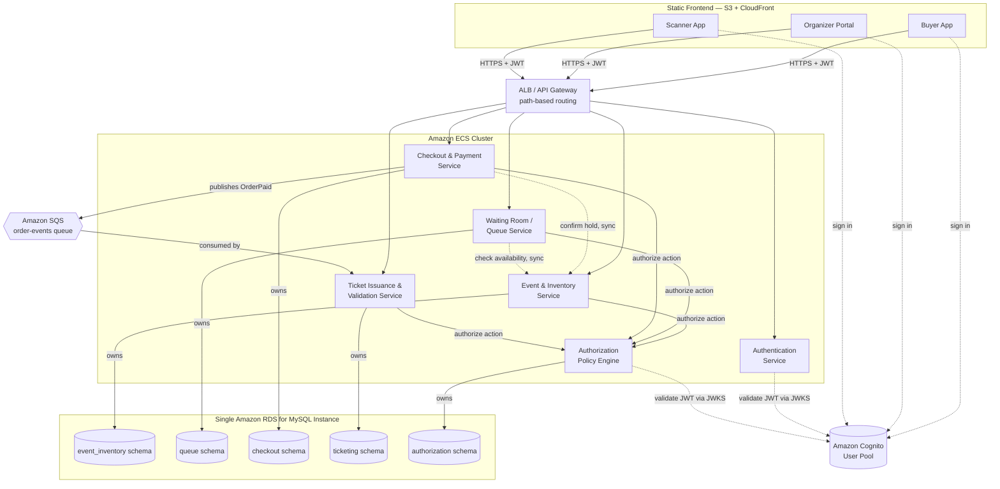

---

## Design decisions

**One database, five schemas, no cross-schema foreign keys.** A single Amazon RDS for MySQL instance hosts `event_inventory`, `queue`, `checkout`, `ticketing`, and `authorization` — one per service — instead of five separate RDS instances, which keeps the school project's AWS bill and ops surface small. Each service's own tables carry real, enforced foreign keys. A reference to another service's row (e.g. `checkout.orders.event_id` or `authorization.event_role_assignments.event_id`) is stored as a plain unconstrained column instead, so the services stay logically independent and could be split onto separate instances later with zero schema change.

**Only one thing has to be synchronous: not overselling.** The one failure OneStage cannot tolerate is two buyers being confirmed for the same seat. So reserving and confirming an `InventoryHold` happens inside the Event & Inventory Service under a DB transaction, and Checkout calls `POST /holds/{id}/confirm` synchronously before it will mark an order `PAID` — if that call fails, the sale fails. Ticket generation and the confirmation email are not on that critical path, so Checkout instead publishes `OrderPaid` to the `order-events` SQS queue and Ticket Issuance consumes it asynchronously. That's the proposal's "event bus that decouples inventory and order events from downstream processing," scoped to the one hand-off where eventual consistency is actually fine.

**Authentication and authorization are separate concerns.** Cognito authenticates users and issues tokens. The Authorization Policy Engine maps the token's immutable `sub` claim to an application user, loads event-role facts from its own schema, and evaluates action-specific policy in version-controlled code. Organizer and Event Helper are per-event roles and therefore do not become Cognito groups. Every domain service remains responsible for enforcing the returned decision before performing the requested action.

**What's deliberately left out.** Network firewalls and WAF rules, a service mesh, and rate limiting beyond the waiting room's own admission control are out of scope. IDs below are plain auto-increment `BIGINT`s rather than UUIDs, and every domain-specific "email" field is a denormalized snapshot taken from the Cognito JWT at write time, so no service has to call another just to render a name.

---

## Authentication and authorization

Authentication answers *who is making the request*. Authorization answers *whether that user may perform this action on this resource*. Cognito is the identity provider, the stateless Authentication Service exposes the backend identity-verification boundary, the Authorization Policy Engine is the central policy decision point, and each domain service is a policy enforcement point. The Authentication Service owns no credential or password database because Cognito owns credentials, MFA, token issuance, and browser sessions.

### Authentication flow — Cognito Hosted UI with Authorization Code and PKCE

The browser never handles a client secret. It generates a PKCE verifier/challenge, redirects the user to Cognito Managed Login, receives a short-lived authorization code, and exchanges that code plus the verifier for tokens. The frontend sends the Cognito **access token**, not the ID token, as the API bearer token.

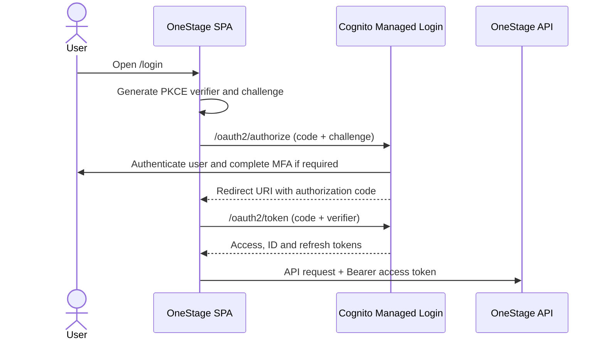

The access token is validated for signature, issuer, expiry, app client, and `token_use=access`. The immutable Cognito `sub` claim is the external identity key. Email and username are not authorization identifiers because they can change.

### Cognito-managed authentication endpoints

These endpoints belong to Amazon Cognito, not to a OneStage backend service. The OAuth endpoints use the configured Hosted UI domain, while OIDC discovery and signing keys use the user-pool issuer domain. They are listed because the SPA and backend token validators depend on their contract. They are not included in the OneStage API endpoint total above.

| Method | Path | Cognito host | Purpose | Caller |
|---|---|---|---|---|
| GET | `/oauth2/authorize` | Hosted UI domain | Start Managed Login using Authorization Code and PKCE | SPA / browser |
| POST | `/oauth2/token` | Hosted UI domain | Exchange an authorization code or refresh token for tokens | SPA OAuth library |
| GET | `/logout` | Hosted UI domain | End the Cognito browser session and redirect to an allowed sign-out URL | SPA / browser |
| GET | `/.well-known/openid-configuration` | User-pool issuer domain | Discover issuer and OAuth/OIDC endpoint metadata | OAuth clients / tooling |
| GET | `/.well-known/jwks.json` | User-pool issuer domain | Retrieve public keys used to validate Cognito JWT signatures | Backend token verifier |

The app client is public and therefore has no client secret in the browser. Callback URLs, sign-out URLs, scopes, and Authorization Code grant support are configured on the Cognito app client.

### OneStage Authentication Service endpoints

| Method | Path | Description | Caller |
|---|---|---|---|
| GET | `/auth/me` | Validate the access token and return safe identity claims | Authenticated SPA / diagnostics |
| GET | `/auth/health` | Report liveness/readiness without exposing Cognito configuration or secrets | Platform / load balancer |
| POST | `/auth/roles/sync` | Transitional synchronization of the legacy Cognito Customer group | SPA during migration only |

`POST /auth/roles/sync` exists in the current implementation but is deprecated in the target architecture. It must not grant Organizer or Event Helper access, and it is removed after all authorization decisions use RDS-backed assignments. New event-role behavior must not depend on Cognito groups or claims populated by this endpoint.

### Authorization decision flow

The domain service passes the original Cognito access token and a semantic action/resource request to the Authorization Policy Engine. The frontend may hide unavailable controls for usability, but frontend state is never an authorization authority.

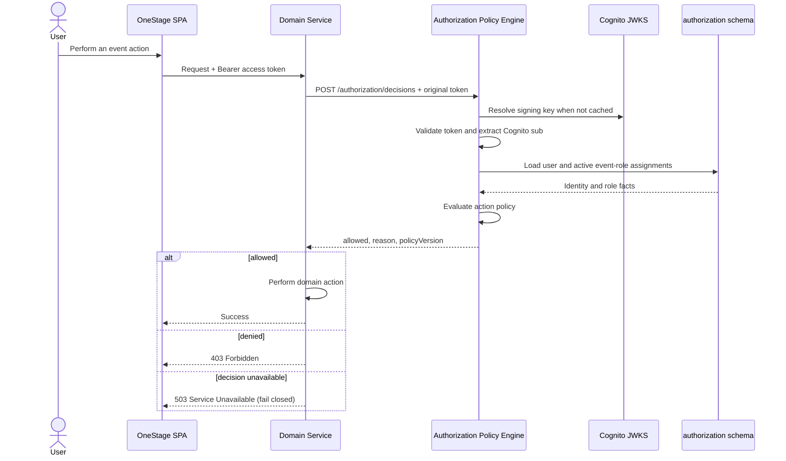

The policy engine returns a decision; it does not perform the business action. Unknown actions, invalid resource context, database failures, and indeterminate decisions never default to allow.

### Authorization data model — `authorization` schema

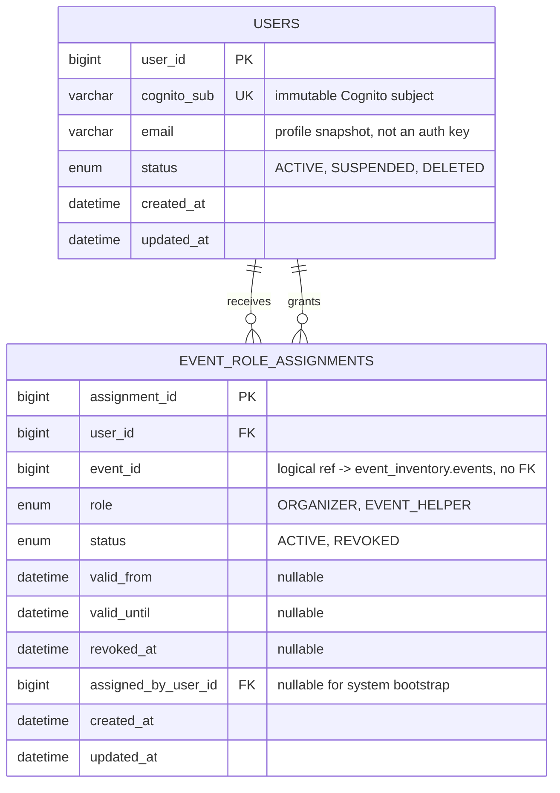

`users` is a local application identity projection, not an authentication store. It contains no password, access token, refresh token, MFA secret, or Cognito client secret. A unique `cognito_sub` maps a validated Cognito identity to the internal `user_id` used by role assignments and audit records.

`event_role_assignments` stores privileged, event-scoped facts. A unique `(event_id, user_id, role)` constraint allows a user to hold more than one independent role for the same event. The authorization lookup is indexed by `(user_id, event_id, status)`. An assignment is effective only when it is active and within its optional validity window. Removing access is a soft revoke: the service changes `status` to `REVOKED` and records `revoked_at`, retaining the row for audit. Reassigning the same role reactivates that row and refreshes its grant metadata rather than inserting a duplicate. Assignment, revocation, and reactivation operations are idempotent.

An authenticated active user is a Customer by default. Customer access is derived from domain ownership such as `orders.customer_sub`, `tickets.customer_sub`, or an event registration—not from a `CUSTOMER` row for every user/event combination. This avoids duplicating business facts and avoids growth proportional to every possible user/event pair.

### Central policy model

Role assignments are facts stored in RDS. Action-to-role policy remains in version-controlled application code so developers can review and change authorization behavior in one place.

| Action | Required facts |
|---|---|
| `event:create` | Authenticated, active user |
| `event:update` | Active `ORGANIZER` assignment for the event |
| `event:publish` | Active `ORGANIZER` assignment for the event |
| `event-helper:assign` | Active `ORGANIZER` assignment for the event |
| `ticket:check-in` | Active `ORGANIZER` or `EVENT_HELPER` assignment for the event |
| `order:view` | Authenticated user owns the order |

### Authorization API endpoints

| Method | Path | Description | Caller |
|---|---|---|---|
| POST | `/authorization/decisions` | Evaluate an action against a resource | Backend services |
| GET | `/authorization/users/me` | Resolve the authenticated Cognito subject to the application user | Authenticated user |
| POST | `/authorization/events/{eventId}/role-assignments` | Assign Organizer or Event Helper | Organizer / system bootstrap |
| GET | `/authorization/events/{eventId}/role-assignments` | List active and historical event assignments | Organizer / Event Helper |
| PATCH | `/authorization/events/{eventId}/role-assignments/{assignmentId}` | Change validity or status | Organizer |
| DELETE | `/authorization/events/{eventId}/role-assignments/{assignmentId}` | Revoke an assignment idempotently | Organizer |
| GET | `/authorization/health` | Report policy-engine and database readiness without exposing secrets | Platform / load balancer |

An invalid or expired token returns `401`. A valid user without the required permission receives an `allowed: false` decision, which the calling service enforces as `403`. If the policy engine or its database cannot make a trustworthy decision, the caller returns `503` and performs no protected action. Calls use bounded timeouts, correlation IDs, structured logs without tokens, and no decision caching initially so revocation is visible on the next request.

### Event creator bootstrap

Creating an event and assigning its creator as Organizer spans two service-owned schemas, so it cannot use one database transaction. The operation must be idempotent and must not expose an organizer-less event as ready for use.

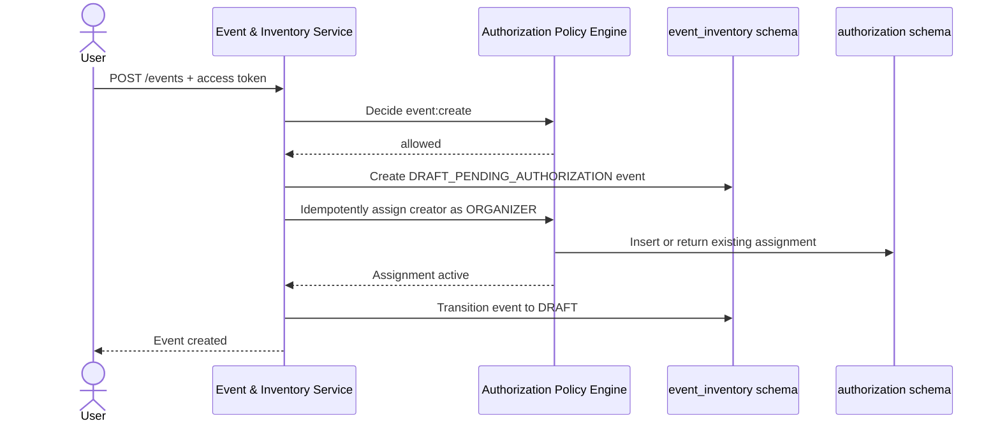

If assignment fails, the event remains non-publishable and the service retries safely using the event id as the idempotency boundary. A later outbox-based workflow may replace the synchronous bootstrap if reliability or scale requires it.

### Current implementation and migration considerations

This document describes the **target architecture**. The current backend schema still contains `customers` and stores one `events.organizer_id` foreign key. It does not yet contain the target `authorization.users` or `authorization.event_role_assignments` tables.

Database migration remains a separate, explicitly reviewed change. A safe rollout is additive: introduce the identity and assignment tables, backfill Cognito subjects and existing organizers, temporarily reconcile old and new organizer representations, switch authorization reads to the policy engine, and remove the legacy organizer source only in a later cleanup migration. No cross-schema foreign key is introduced, and the old source is not removed until all consumers have cut over and consistency checks pass.

---

## Event & Inventory Service — `event_inventory` schema

The platform's core technical risk: owns events, their inventory (GA quantity or a seat map), and the concurrency-safe hold that guarantees a seat or quantity is never sold twice. Event-role assignments belong to the Authorization Policy Engine.

### Data model

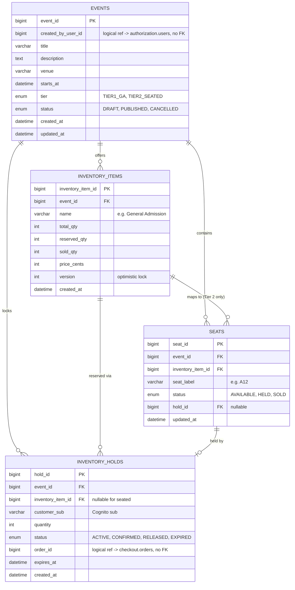

### Domain model

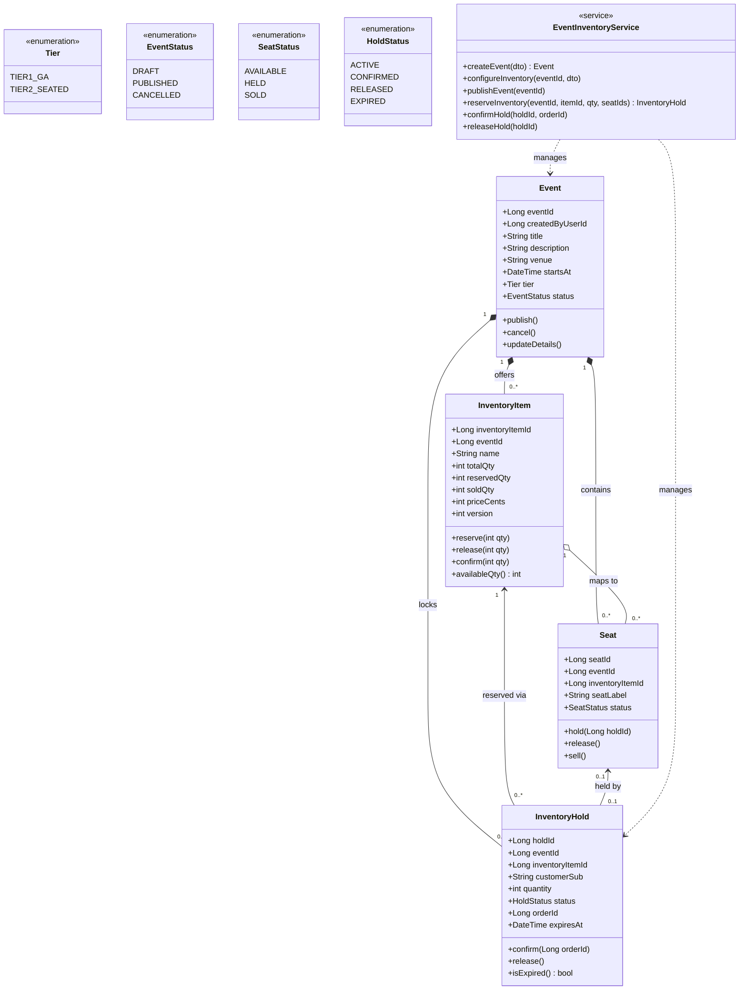

### API endpoints

| Method | Path | Description | Caller |
|---|---|---|---|
| POST | `/events` | Create a draft event (creator becomes Organiser) | Customer |
| GET | `/events` | Browse / search published events | Any |
| GET | `/events/{eventId}` | Event detail incl. live availability | Any |
| PUT | `/events/{eventId}` | Edit event details | Organiser |
| POST | `/events/{eventId}/publish` | Publish the event | Organiser |
| POST | `/events/{eventId}/cancel` | Cancel the event | Organiser |
| PUT | `/events/{eventId}/inventory` | Configure ticket quantity / seat map | Organiser |
| GET | `/events/{eventId}/seats` | Seat map with live status | Any |
| POST | `/events/{eventId}/inventory/hold` | Reserve seats / quantity (soft lock) | Customer |
| POST | `/holds/{holdId}/release` | Release a hold | Customer / internal sweep |
| POST | `/holds/{holdId}/confirm` | Confirm a hold as sold (sync, no-oversell path) | Checkout Service |

---

## Waiting Room / Queue Service — `queue` schema

Sits in front of Tier 2 on-sales only. Holds no inventory of its own — it just orders customers into a line and admits them in batches, checking availability against the Event & Inventory Service before letting anyone through.

### Data model

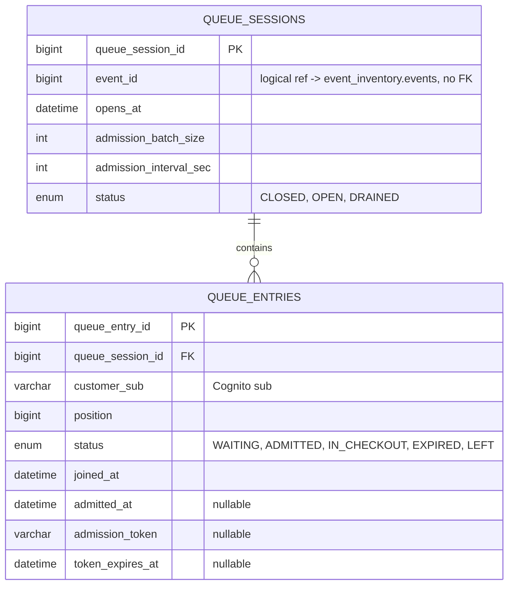

### Domain model

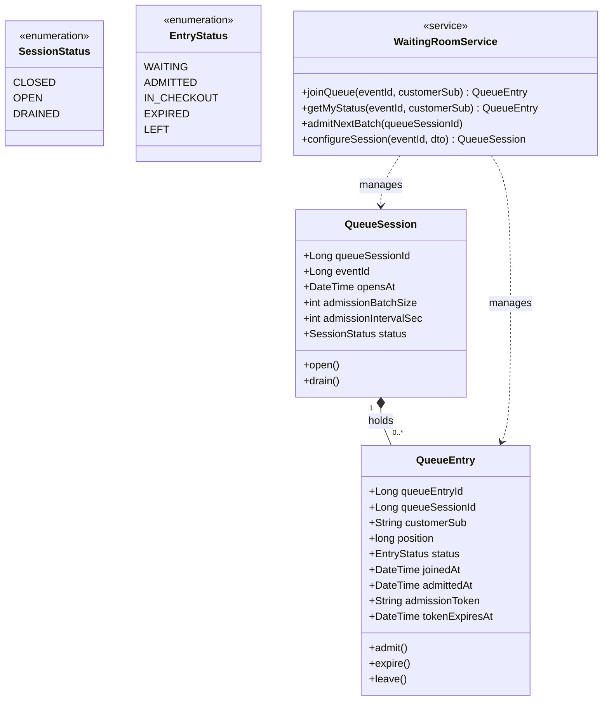

### API endpoints

| Method | Path | Description | Caller |
|---|---|---|---|
| PUT | `/events/{eventId}/queue/config` | Configure on-sale time & admission rate | Organiser |
| POST | `/events/{eventId}/queue/join` | Join the waiting room | Customer |
| GET | `/events/{eventId}/queue/me` | My live position & status | Customer |
| POST | `/events/{eventId}/queue/admit-next` | Admit the next batch (scheduled) | Internal (scheduled task) |

---

## Checkout & Payment Service — `checkout` schema

Turns a confirmed hold into a paid order using a simulated, tokenized payment — no real card data ever reaches this schema. Owns the sales figures and attendee contact details organisers see on their dashboard.

### Data model

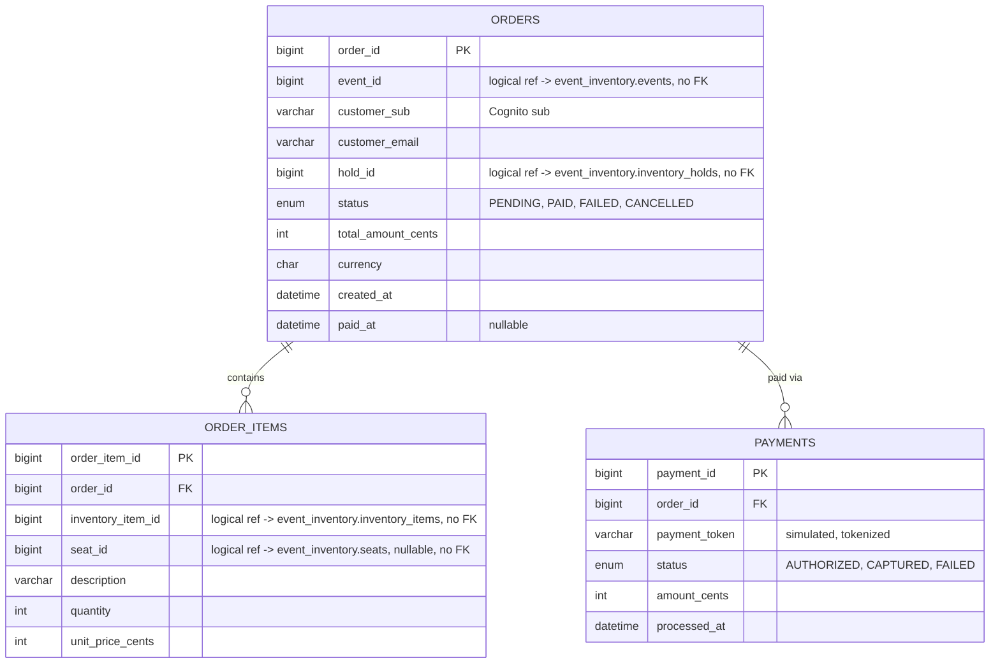

### Domain model

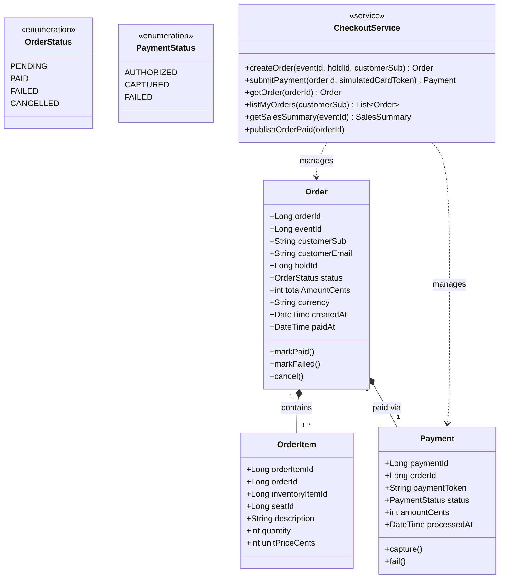

### API endpoints

| Method | Path | Description | Caller |
|---|---|---|---|
| POST | `/orders` | Create an order from a hold | Customer |
| POST | `/orders/{orderId}/payment` | Submit simulated, tokenized payment | Customer |
| GET | `/orders/{orderId}` | Order detail | Customer (owner) / Organiser |
| GET | `/customers/me/orders` | My order history | Customer |
| GET | `/events/{eventId}/orders/summary` | Sales dashboard data | Organiser / Helper |
| GET | `/events/{eventId}/attendees` | Attendee & order export | Organiser |

---

## Ticket Issuance & Validation Service — `ticketing` schema

Issues the QR-coded ticket after payment and is the single source of truth at the door: the Scanner App and the Buyer App's own "my tickets" view both read ticket state from here, so a ticket can never be checked in twice.

### Data model

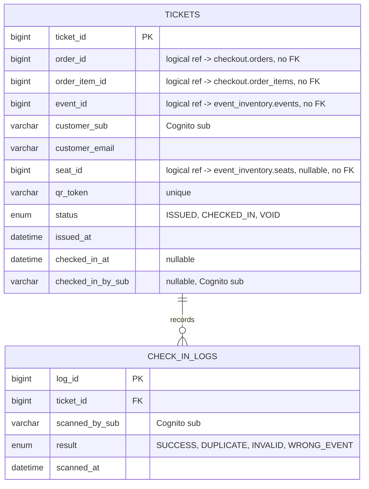

### Domain model

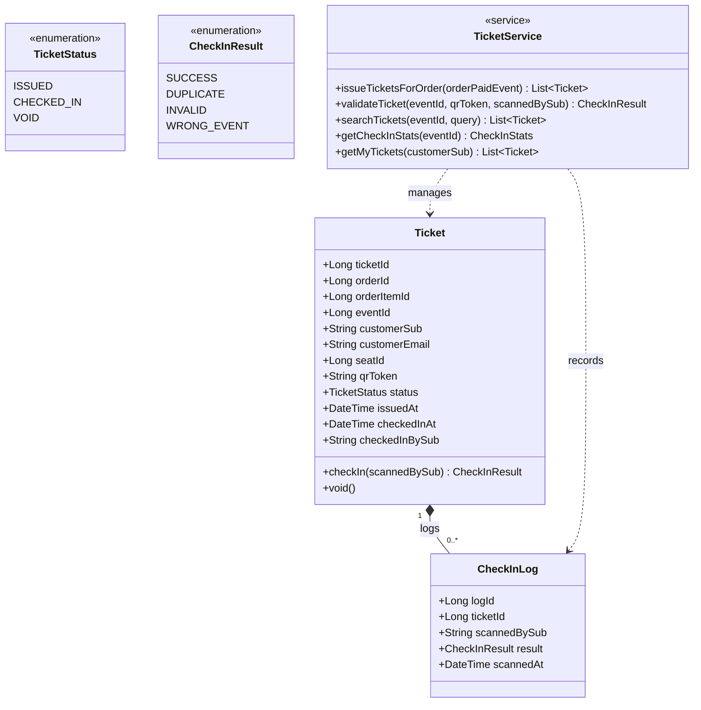

### API endpoints

| Method | Path | Description | Caller |
|---|---|---|---|
| GET | `/customers/me/tickets` | My tickets | Customer |
| GET | `/tickets/{ticketId}` | Ticket detail + QR | Customer (owner) |
| POST | `/tickets/validate` | Scan & validate a QR code | Helper / Organiser |
| GET | `/tickets/search` | Manual lookup by name / email / order ID | Helper / Organiser |
| GET | `/events/{eventId}/checkin-stats` | Live check-in count | Organiser / Helper |
| *(async)* | SQS `order-events` → `OrderPaid` | Consumer: issues ticket(s), sends email | System |

---

## Tier 2 purchase — sync vs. async in one picture

The flow that justifies every choice above: the queue and the inventory hold are synchronous because correctness can't wait; publishing to SQS and issuing the ticket happen after the customer already has a confirmed, paid order.

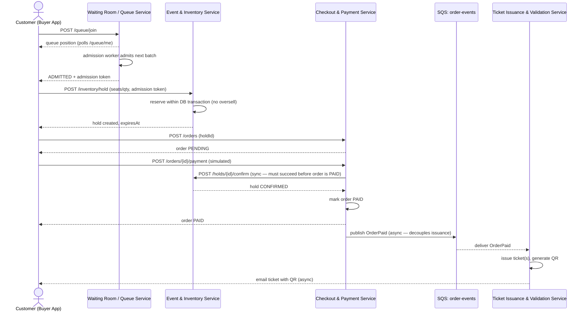

A Tier 1 purchase runs the same path with the Waiting Room steps skipped entirely — `POST /inventory/hold` succeeds immediately since there's no queue to admit from.

---

*Companion document to "OneStage — User Stories & Use-Case Diagrams." IDs, enum values, and endpoint names here are the vocabulary the user stories' acceptance criteria assume — e.g. CU-09's "no seat is ever confirmed to two buyers" is exactly what `InventoryHold` plus the synchronous `/holds/{id}/confirm` call is designed to guarantee.*
