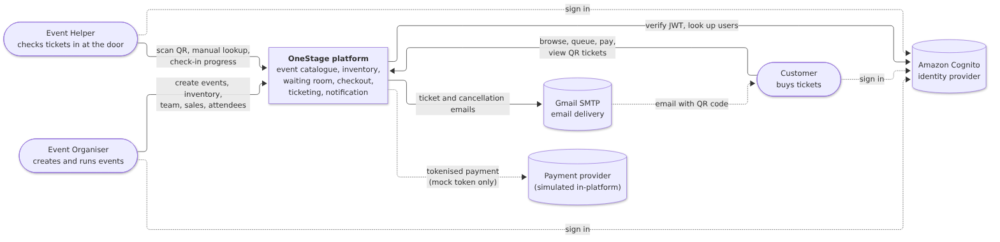

# Solution Overview

OneStage is a ticketing platform for events of any size. One platform sells an 8-seat general-admission workshop and an 8,000-seat seated concert. The design centres on one guarantee: **no seat or ticket is ever sold twice**, even when thousands of buyers arrive in the same second. A virtual waiting room protects that guarantee by levelling the load on large on-sales.

This chapter describes the system as built and deployed on 4 October 2026. The original design (August 2026) is kept in `archive/` as a historical record. The table at the end of this chapter lists where the build departed from it and why.

## System context

Table: Actors and external systems

| Element | Kind | Role in the solution |
|---|---|---|
| Customer | Person | Browses events, joins the waiting room, reserves seats or a quantity, pays and receives QR e-tickets |
| Event Organiser | Person | Creates and publishes events, configures inventory and the waiting room, manages the event team, views sales and attendees, cancels events |
| Event Helper | Person | Scans tickets at the door, looks up attendees manually, watches check-in progress |
| Amazon Cognito | External service (AWS) | Sign-up, sign-in (managed login) and token issue. Services verify the access token and look up user profiles |
| Gmail SMTP | External service | Delivers ticket and cancellation emails |
| Payment provider | Simulated | Payment is tokenised and simulated inside the order service. No card data enters the platform |

## The solution at a glance

Table: Main elements of the as-built solution

| Aspect | As built |
|---|---|
| Client | One Angular 21 single-page application with customer, organiser and helper workspaces |
| Edge | Amazon CloudFront serves the SPA from S3 and forwards `/api/*` to the backend on the same domain |
| Gateway | Kong 3 (DB-less, declarative) behind an Application Load Balancer |
| Business services | Six Node.js/TypeScript Express services (event, inventory, queue, order, ticket, notification) plus a health-only `auth` stub, all built from one container image |
| Messaging | Amazon SQS: `payment-requests` (with dead-letter queue), `order-events`, `customer-admitted` |
| Data | One MySQL 8.0 server with five schemas, one per bounded context, running as an ECS task on encrypted Amazon EFS |
| Compute | Amazon ECS on AWS Fargate, ECS Service Connect for service discovery, target-tracking autoscaling |
| Infrastructure as code | Terraform (one state, S3 backend). GitHub Actions deploy through OIDC-federated IAM roles |
| Scale | 9 ECS services, 5 schemas, 14 tables, 57 business HTTP endpoints (plus a `/health` per service), 3 queues + 1 DLQ |

## How this chapter is organised

Table: Chapter map

| Section | Content |
|---|---|
| Logical Architecture and Design | Logical decisions AD-01 to AD-11, logical detail deployment diagram, tiers and layers, nodes and subsystems |
| Platform Design | Seed, producers and consumers, bounded contexts, context map, aggregates, domain events |
| Physical Architecture and Design | Physical decisions AD-12 to AD-22, physical detail deployment diagram, technology and services |
| Persistence Design | Schemas, logical data model, transactions and concurrency, retention, data classification |
| Detailed Design | Tier 2 purchase under contention; asynchronous payment and ticket issuance; door check-in |
| Other Architectural Decisions | AD-23 to AD-30: delivery, security pipeline, cost and governance decisions |
| Architectural Limitations | AISS-01 to AISS-14 with impact, resolution and status |
| API catalogue | Every HTTP endpoint, by service (appendix) |

## Original design versus the system as built

The August design (kept in the `docs` repository under `archive/`) was a sound starting point. Implementation and testing changed it in the ways below. Each change is now an architectural decision or a recorded limitation.

Table: Where the build departed from the original design

| Topic | Original design (Aug 2026) | As built (Oct 2026) | Why it changed | Recorded as |
|---|---|---|---|---|
| Services | 4 (Event & Inventory, Waiting Room, Checkout, Ticketing) | 6 business services + `auth` stub. Event and inventory split; notification added | Inventory editing (seat maps, zones) grew large enough to deploy separately. Email needed its own failure domain | AD-01, AD-09, AISS-12 |
| Database | Amazon RDS for MySQL | MySQL 8.0 container on Fargate with EFS | RDS cannot scale to zero (auto-restarts after 7 days stopped) and bills storage continuously; budget USD 100/month | AD-13 (ADR-0002), AISS-02 |
| Service boundaries | No cross-schema access; services call each other | Order writes `event_inventory` and `queue` tables in the same transaction; ticket and event also cross schemas | One local ACID transaction is the simplest correct way to prevent oversell | AD-04, AISS-01 |
| No-oversell path | Checkout calls `POST /holds/{id}/confirm` on the inventory service | `POST /orders` reserves and creates the order in one transaction; payment confirms the hold in one transaction | Removes a distributed transaction and its failure modes | AD-02, AD-04 |
| Gateway | ALB or API Gateway path routing | CloudFront → ALB → Kong → Service Connect | Same-origin SPA and API; declarative gateway with rate limiting and correlation ids | AD-14, AD-16 |
| Frontends | 3 SPAs (Buyer, Organiser Portal, Scanner) | 1 Angular SPA with role-based workspaces | One build, one deploy, one sign-in; roles are per event, so one person often needs all three | AD-08 |
| Messaging | 1 SQS queue (`order-events`) | 3 queues + 1 DLQ | Payment became asynchronous; admission events were added for a future push channel | AD-05, AD-19, AISS-08 |
| Payment | Synchronous `POST /orders/{id}/payment` | Asynchronous `payment-requests` (202 + polling); synchronous endpoint kept for compatibility | Resilience to slow payment providers; load levelling of checkout | AD-05 |
| Team removal | Soft revoke (`REVOKED` status kept for audit) | Hard delete of the membership row; invitations add `PENDING`/`ACCEPTED`/`REJECTED` | Simpler invitation model chosen during build | AISS-13 |
| Compute | ECS on EC2 with capacity providers (ADR-0001) | ECS on Fargate (ADR-0003) | EC2 networking failures (NAT instance, ENI trunking) during deployment | AD-12 |
