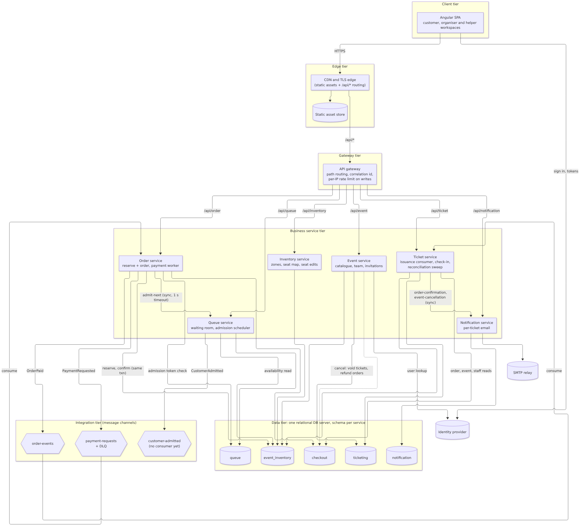
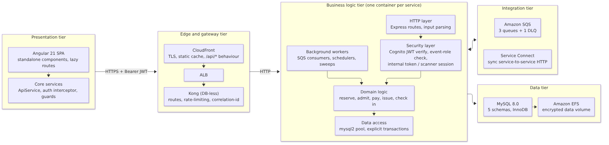

# Logical Architecture and Design

The logical view shows which elements make up OneStage, what each one is responsible for, and how they interact. It is technology-neutral where it can be. The physical view (Physical Architecture and Design) maps each element onto AWS.

Every element is custom-built by the team except the identity provider, the CDN, the API gateway product, the relational database engine, the message broker and the SMTP relay. Those are commercial or open-source products, and the table in "Nodes and subsystems" names the provider of each.

## Key architectural decisions

The decisions are numbered continuously across the logical view (AD-01 to AD-11), the physical view (AD-12 to AD-22) and other decisions (AD-23 to AD-30). Details for each decision follow the table.

Table: Logical architectural decisions

| Identifier | Description |
|---|---|
| AD-01 | Decompose the backend into one microservice per bounded context (event, inventory, queue, order, ticket, notification) behind a single API gateway, built from one shared code base and container image. Trade-off: independent deployment and scaling against more moving parts to operate |
| AD-02 | Keep the correctness-critical path (reserve, then capture) synchronous and lock-based, and make everything after a successful capture asynchronous. Trade-off: guaranteed no-oversell against lower throughput on contended rows |
| AD-03 | Put a virtual waiting room in front of Tier 2 (seated) on-sales only, admitting buyers in batches bounded by a concurrent-buyer cap and by the seats left, with short-lived admission tokens. Trade-off: fairness and load levelling against added wait time |
| AD-04 | Use one relational database server with one schema per service, but allow the order service to read and write `event_inventory` and `queue` tables inside its own transactions. Trade-off: one local ACID transaction instead of a distributed one, against data-layer coupling (AISS-01) |
| AD-05 | Process payment asynchronously through a command queue with a dead-letter queue and an idempotent capture, answering `202 Accepted` and letting the client poll. Keep the synchronous endpoint for older clients. Trade-off: resilience and load levelling against a polling user experience |
| AD-06 | Issue tickets by choreography: the order service publishes `OrderPaid`, and the ticket service consumes it idempotently, with a reconciliation sweep as a safety net. Trade-off: decoupled, retryable issuance against a delay of about 10–20 s before tickets appear |
| AD-07 | Model Organiser and Helper as roles per event in a database table, not as global identity-provider groups. Any signed-in user is a Customer. Trade-off: flexible per-event teams against an extra lookup on every staff request |
| AD-08 | Build one SPA with customer, organiser and helper workspaces instead of three separate applications. Trade-off: one build, deploy and sign-in against a larger bundle and shared blast radius |
| AD-09 | Make email delivery a separate notification service that sends one email per ticket, is idempotent per ticket, and never reverses a sale when delivery fails. Trade-off: isolation of a slow, flaky dependency against another service to run |
| AD-10 | Run background work (payment worker, `OrderPaid` consumer, admission scheduler, reconciliation sweeps) inside the API service that owns the data, made safe for many replicas by database locks. Trade-off: no extra services to run against workers scaling with API load rather than queue depth (AISS-09) |
| AD-11 | Enforce per-client rate limiting at the gateway on the write paths a bot would target (queue join, order create, payment, cancel), keyed on the real client IP. Trade-off: cheap anti-bot flow control against false positives for many buyers behind one NAT |

### AD-01 Microservices per bounded context behind one gateway

**Context.** The platform has distinct sub-problems with different load profiles. Browsing is read-heavy, queue polling is high-volume and cheap, and checkout is low-volume, contended and must be correct. The brief asks for a platform that can be extended with new use cases.

**Decision.** Six business services, one per bounded context (see "Platform Design"). Each service owns its schema, its routes under `/api/<service>` and its own autoscaling policy. All services live in one repository and are built into one container image; the `SERVICE` environment variable selects which service a task runs.

**Alternatives.** A modular monolith would be simpler to run and would keep transactions local, but it could not scale the queue separately from checkout. One repository and image per service would give stronger isolation but cost more pipeline and infrastructure work than a small student team could justify in one semester.

**Trade-off and consequences.** Each context scales on its own (queue polling does not starve checkout), and a fault in email delivery cannot take down the purchase path. The cost is nine ECS services to deploy and monitor. The single image means one change rebuilds every service, which is acceptable at this size. The `auth` service is a health-only stub kept for future use (AISS-12).

### AD-02 Synchronous, lock-based correctness path; asynchronous everything else

**Context.** The one failure OneStage cannot tolerate is selling the same seat or the same unit of capacity twice (CU-09). Ticket generation and email can tolerate a delay of seconds.

**Decision.** Reservation and capture each run as a single database transaction that takes pessimistic row locks (`SELECT ... FOR UPDATE`) in a fixed order (seats ordered by `seat_id`) to avoid deadlocks. A `CHECK (reserved_qty + sold_qty <= total_qty)` constraint and row-count assertions on every update are a second line of defence. After the capture commits, ticket issuance and email run asynchronously (AD-06, AD-09).

**Alternatives.** Optimistic concurrency alone (version check and retry) behaves badly when hundreds of buyers want the same seat, because most retries fail. A saga across separate inventory and order databases needs compensation logic and allows windows of inconsistency.

**Trade-off and consequences.** No oversell by construction, and it is easy to explain and test (an end-to-end test runs two customers against one seat). Throughput on a single hot row is bounded by lock hold time, which is why the waiting room (AD-03) limits how many buyers reach this path at once.

### AD-03 Virtual waiting room for Tier 2 on-sales

**Context.** A popular seated on-sale can draw far more buyers than seats in the first minute. Letting all of them hit checkout would saturate the database and lock contention would turn into errors.

**Decision.** Tier 2 events have a queue session. Buyers join and poll their position. A scheduler in the queue service admits the next batch when the admission interval has elapsed. A batch is bounded by the concurrent-buyer cap (`available_buyers`, default 10% of total seats, minimum 1) minus buyers already admitted, and by the seats still available. Each admitted buyer gets a random admission token valid for 600 seconds, which `POST /orders` checks under a row lock. When a buyer pays, fails or cancels, the order service asks the queue to refill the slot at once. Tier 1 events skip the queue.

**Alternatives.** Rate limiting alone sheds load but is unfair (whoever retries fastest wins). A managed waiting room product would add cost and an external dependency.

**Trade-off and consequences.** This is queue-based load levelling: the arrival spike is absorbed by cheap position polls, while the checkout path sees a steady, bounded rate. Polling is the cost. With 40,000 buyers polling every 3 s, Little's Law gives about 13,300 requests/s on `/queue/me`, which makes the poll endpoint the likely scaling limit (see AISS-02 and the Performance chapter). Estimated wait time (CU-05) is not shown yet (AISS-14).

### AD-04 One database server, schema per service, local transactions across the inventory domain

**Context.** Reserve-and-order and capture each need to change inventory, order and queue state atomically. Separate databases would force a distributed transaction or a saga.

**Decision.** One MySQL server hosts five schemas: `event_inventory`, `queue`, `checkout`, `ticketing` and `notification`. Each service connects to its own schema by default. The order service also reads and writes `event_inventory.inventory_holds`, `inventory_items`, `seats` and `queue.queue_entries` inside its own transactions. The event service's cancel operation and the ticket service's reconciliation also write across schemas. References between schemas are plain columns with no foreign keys, so the schemas could later move to separate servers.

**Alternatives.** Database per service with a saga and compensating release (the textbook choice) needs an orchestrator and outbox, and still allows a short window where a seat looks free but is about to be sold. Sharing a single schema would lose the ownership boundary entirely.

**Trade-off and consequences.** The cheapest correct way to guarantee no oversell, following the guidance that sharing data inside a domain boundary is acceptable. The cost is real coupling: schema changes in `event_inventory` can break the order and ticket services, and the database is a shared scaling limit and a single point of failure. This is recorded as AISS-01 with a roadmap.

### AD-05 Asynchronous payment with a command queue and DLQ

**Context.** Real payment providers can be slow or briefly unavailable. A synchronous call would hold a request thread and a database connection for the provider's latency, and a timeout would leave the customer unsure whether they paid.

**Decision.** `POST /orders/{id}/payment-requests` checks the caller owns the order, puts a `PaymentRequested` v1 command (order id and customer only, no card data) on `payment-requests` with a 7 s delay, and answers `202 PROCESSING`. A worker captures the payment in one transaction. The order row lock and the "already PAID" check make a duplicate delivery harmless. After five failed receives a message moves to the dead-letter queue, where a CloudWatch alarm watches it. The SPA polls `GET /orders/{id}` every 2 s. The older synchronous `POST /orders/{id}/payment` still works, so the change was additive (expand and contract).

**Trade-off and consequences.** Checkout survives payment slowness and absorbs bursts. The cost is a polling UX and a few seconds' extra latency. The DLQ alarm has no notification target yet (AISS-10).

### AD-06 Ticket issuance by `OrderPaid` choreography

**Context.** Tickets must be issued exactly once per paid unit, even if a message is delivered twice or a consumer crashes mid-way.

**Decision.** After capture, the order service publishes `OrderPaid` v1 (order, customer and line items) to `order-events` with a 10 s delay. The ticket service long-polls the queue, takes a named database lock per order (`GET_LOCK('ticket-order-<id>')`), counts tickets already issued per order item and inserts only the missing ones, each with a random 32-byte QR token. It deletes the message only after issuance commits. A reconciliation sweep in the ticket service issues tickets for any paid order the consumer missed and processes cancelled events.

**Trade-off and consequences.** Issuance is idempotent and self-healing, and the payment path does not wait for it. Tickets appear about 10–20 s after payment, which the UI covers with an "issuing" state.

### AD-07 Event-scoped roles in a database table

**Context.** A person can organise one event, help at another and buy tickets to a third. Global identity-provider groups cannot express "Organiser of event 42 only".

**Decision.** `event_team_memberships` holds `(event_id, user_sub, role, invite_status)`. Creating an event inserts the creator as an accepted Organiser. Organisers invite others by email (the event service resolves the email to a Cognito user), and the invitee accepts or rejects. Every staff-only endpoint checks this table. Every other endpoint only needs a valid access token.

**Trade-off and consequences.** Flexible teams, and any customer can become an organiser of their own event, which grows the platform. Each staff request costs one indexed lookup. Removal is a hard delete, so there is no audit trail of past access (AISS-13).

### AD-08 One SPA with role-based workspaces

**Context.** The proposal planned separate Buyer, Organiser Portal and Scanner apps.

**Decision.** One Angular application with lazy-loaded routes for each workspace (`/events`, `/organiser/...`, `/helper`, `/checkin/:eventId`) and a route guard for signed-in areas. What a user sees depends on their memberships.

**Trade-off and consequences.** One build, one deployment, one sign-in and shared components (seat map, reservation card). Lazy loading keeps the first download small. A defect in shared code can affect every workspace, which the unit and end-to-end suites guard against.

### AD-09 Separate notification service, one email per ticket

**Decision.** The ticket service calls `POST /notifications/order-confirmation` without waiting for the result. The notification service sends one email per ticket, each with only that ticket's QR code, and records one `email_notifications` row per ticket with a unique key on `ticket_id`. A retry skips tickets already `SENT` and resends only `FAILED` ones. A delivery failure is recorded and answered with 201: the order is already paid and the tickets exist, so a broken mail credential means "no email", never "no sale". Cancellation emails follow the same pattern.

**Trade-off and consequences.** SMTP slowness and failures are isolated from payment and issuance. The service currently trusts its callers, and the gateway exposes it publicly (AISS-03).

### AD-10 Background workers inside the owning service

**Decision.** The payment worker runs in the order task, the `OrderPaid` consumer and reconciliation sweeps in the ticket task, and the admission scheduler (every 1 s) in the queue task. Each is safe when the service has several replicas: SQS hands each message to one consumer, and the admission scheduler is serialised by `SELECT ... FOR UPDATE` on the queue session row.

**Trade-off and consequences.** No extra services or deployments. Workers scale with API CPU, not with queue depth, and a slow worker shares CPU with request handling (AISS-09).

### AD-11 Per-client rate limiting on write paths at the gateway

**Decision.** Kong's `rate-limiting` plugin allows 60 POST requests per minute per client IP on the queue and order services. GET polling and `/health` are not limited. Kong recovers the viewer's IP from `X-Forwarded-For` by trusting only the VPC and CloudFront origin-facing ranges, so a forged header prefix is ignored.

**Trade-off and consequences.** A cheap control against bots hammering join and checkout, matching the "shed load" and "flow control" tactics. Counters are kept per Kong task, so with N tasks a client can get up to N × 60 per minute. Many buyers behind one NAT share a limit, and a single-machine load test also looks like one client, which the load test design must account for.

## Logical detail deployment diagram

Solid arrows show calls each element makes in its normal role. Dashed arrows into schemas show the cross-schema access allowed by AD-04. The three message channels carry the domain events described in "Platform Design".

## Tiers and layers

Table: Tiers

| Tier | Elements | Responsibility |
|---|---|---|
| Presentation | Angular SPA | Screens for the three workspaces; holds the user's tokens; calls the API with a Bearer token |
| Edge | CDN | TLS termination, static asset caching, routing `/api/*` to the backend on the same origin |
| Gateway | API gateway | Single entry to the backend; path routing; per-IP rate limiting on writes; correlation id |
| Business logic | Six services | Domain rules, authorisation, transactions, background workers |
| Integration | Message queues; service-to-service HTTP | Asynchronous commands and events; a few synchronous internal calls |
| Data | Relational database, encrypted file storage | Durable state, one schema per service |

Inside each service the code follows the same layers: the HTTP layer parses and validates input; the security layer verifies the access token and checks event roles; the domain logic runs inside explicit transactions; the data access layer uses a pooled `mysql2` connection. Background workers call the same domain logic as the routes.

## Nodes and subsystems

Table: Solution elements and providers

| Element | Type | Responsibility | Provider |
|---|---|---|---|
| Angular SPA | Custom application | Customer, organiser and helper workspaces; QR scanning in the browser | Team |
| Event service | Custom microservice | Event catalogue, publishing, cancellation, images, team and invitations | Team |
| Inventory service | Custom microservice | Zones, seat-map layout and generation, seat edits, availability views | Team |
| Queue service | Custom microservice | Waiting room sessions and entries, admission scheduler, `CustomerAdmitted` events | Team |
| Order service | Custom microservice | Reserve-and-order, payment requests and worker, cancellations, sales summary, attendee list | Team |
| Ticket service | Custom microservice | Ticket issuance, my tickets, scanner sessions, check-in, manual lookup, check-in statistics, reconciliation | Team |
| Notification service | Custom microservice | Per-ticket confirmation and cancellation emails with delivery records | Team |
| `auth` service | Custom microservice (stub) | Health endpoint only; reserved for future identity features | Team |
| API gateway | Open-source product | Routing, rate limiting, correlation id | Kong Inc. (Kong Gateway OSS) |
| CDN | Cloud service | TLS edge, static hosting, API forwarding | AWS (CloudFront, S3) |
| Identity provider | Cloud service | Sign-up, sign-in, tokens, user directory | AWS (Cognito) |
| Message broker | Cloud service | Queues and dead-letter queue | AWS (SQS) |
| Relational database | Open-source product | Durable state for all contexts | Oracle (MySQL Community 8.0), run by the team |
| SMTP relay | External service | Email delivery | Google (Gmail) |

The subsystems map to the bounded contexts in "Platform Design". The purchase subsystem (inventory, queue and order) is the architecturally significant one: its detailed design is in "Detailed Design".
