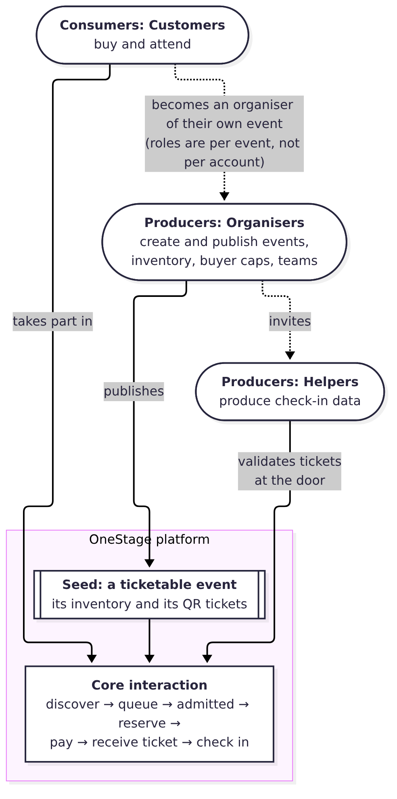
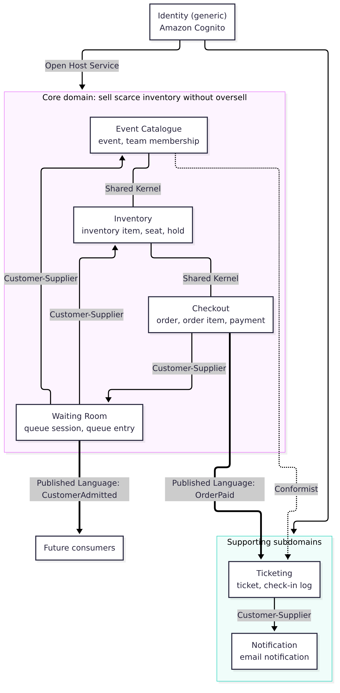
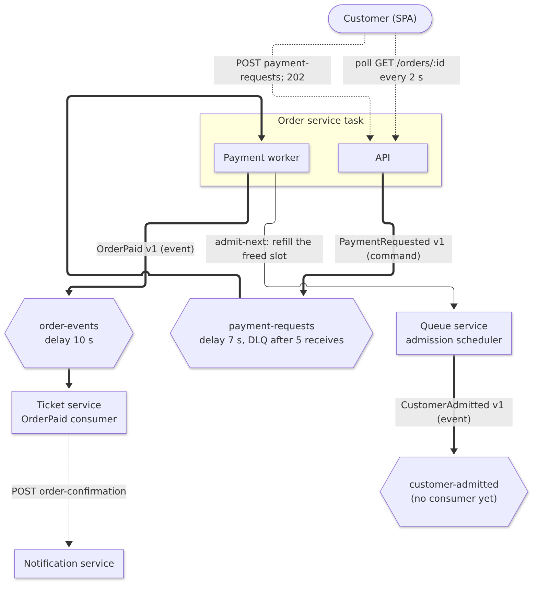

# Platform Design

This section explains how OneStage works as a platform: what it is built around, who produces and consumes value on it, and how its domain is split into bounded contexts that interact through clear contracts.

## Platform thinking: seed, producers, consumers and interactions

Table: Platform elements

| Element | OneStage |
|---|---|
| Seed | A ticketable event: its inventory (a general-admission quantity or a seat map) and the QR tickets sold against it |
| Producers | Organisers, who create events, configure inventory and how many buyers may shop at once, and build event teams. Helpers produce check-in data at the door |
| Consumers | Customers, who discover, queue for, buy and attend events |
| Core interaction | Discover → queue → admitted → reserve → pay → receive ticket → check in |
| Value to producers | Sell from 8 tickets to many thousands on one platform without oversell, with no on-sale setup beyond publishing; live sales, attendee and check-in views; a team with per-event roles |
| Value to consumers | A fair queue for every event, places in several queues at once, a guaranteed seat once reserved, a QR ticket by email (general-admission tickets carry a section number) |
| Ecosystem growth | Roles are per event, not per account, so any customer can create an event and become an organiser. This converts consumers into producers without a separate sign-up |

The two event tiers show that one platform serves both ends of the market. A Tier 1 event (for example an 8-seat workshop or a standing festival) sells a quantity from one or more priced sections. A Tier 2 event (for example a 400-seat theatre) sells specific seats from a seat map. Both use the same queue, the same services, the same no-oversell transaction and the same ticketing; only the ticket-selection step differs.

## Bounded contexts

Table: Bounded contexts

| Context | Subdomain type | Service | Schema | Ubiquitous language |
|---|---|---|---|---|
| Event Catalogue | Core | event | `event_inventory` | event, tier, publish, cancel, organiser, helper, invitation |
| Inventory | Core | inventory (configuration); order (reserve and confirm) | `event_inventory` | inventory item (zone), seat, seat map, hold, available, held, sold, blocked |
| Waiting Room | Core | queue | `queue` | queue session, entry, position, queue place, admission batch, admission token, buyer cap |
| Checkout | Core | order | `checkout` | order, order item, payment request, capture, refund |
| Ticketing | Supporting | ticket | `ticketing` | ticket, QR token, section seat number, scanner session, check-in, duplicate, wrong event |
| Notification | Supporting | notification | `notification` | email notification, sent, failed |
| Identity | Generic | Amazon Cognito | (external) | user, sub, access token |

## Context map

Table: Relationships between contexts

| Upstream | Downstream | Relationship | Mechanism | Notes |
|---|---|---|---|---|
| Event Catalogue | Inventory | Shared Kernel | Same `event_inventory` schema | Inventory items and seats belong to an event |
| Inventory | Checkout | Shared Kernel | Checkout writes holds, seats and quantities in its own transaction | The deliberate coupling of AD-04 (AISS-01) |
| Inventory | Waiting Room | Customer-Supplier | Waiting Room reads availability (seats or section quantities) to size each batch and to mark a sold-out queue `DRAINED` | Read-only |
| Event Catalogue | Waiting Room | Customer-Supplier | Waiting Room reads the event's status, start time and buyer cap to open or close the queue and bound each batch | Read-only; publishing is the only on-sale step |
| Waiting Room | Checkout | Customer-Supplier | Checkout checks the admission token and moves the entry to `IN_CHECKOUT`; asks the queue to refill a freed slot | Token check is a direct read; refill is HTTP with a 1 s timeout |
| Checkout | Ticketing | Published Language | `OrderPaid` v1 on SQS | Versioned JSON; unknown message types are discarded |
| Waiting Room | (future) | Published Language | `CustomerAdmitted` v1 on SQS | Published, not yet consumed (AISS-08) |
| Ticketing | Notification | Customer-Supplier | REST over Service Connect with an internal token, idempotent per ticket | Fire and forget from the ticket service; no public route |
| Event Catalogue | Ticketing, Checkout | Conformist (coupled) | Cancel writes `tickets.status = VOID` and `orders.status = CANCELLED` directly | Part of AISS-01 |
| Identity | All | Open Host Service | Access tokens verified locally in each service | No anti-corruption layer beyond reading `sub` and `email` claims |

## Aggregates

An aggregate is the unit that must stay consistent inside one transaction. The aggregate roots below are the rows that each transaction locks first.

Table: Aggregates and their invariants

| Aggregate (root first) | Context | Invariants protected |
|---|---|---|
| InventoryItem; Seat; InventoryHold | Inventory | `reserved_qty + sold_qty <= total_qty`; a seat is held by at most one active hold; a hold is confirmed at most once; seats are locked in `seat_id` order |
| Order; OrderItem; Payment | Checkout | One order per hold (`uq_orders_hold`); captured at most once; prices are snapshotted at order time |
| QueueSession; QueueEntry | Waiting Room | At most one session per event, created by the first join; one entry per customer per session; admitted buyers never exceed the buyer cap or the seats left; admission is serialised per session |
| Ticket; CheckInLog; GaSectionCounter | Ticketing | One ticket per paid unit; unique QR token; general-admission seat numbers unique per section; checked in at most once; every scan attempt logged |
| Event; EventTeamMembership | Event Catalogue | One membership per user per event; the owner is always an Organiser |
| EmailNotification | Notification | At most one successful email per ticket |

The Inventory and Checkout aggregates are changed together in one transaction. Strict DDD would keep them in separate transactions and coordinate them with a saga. AD-04 records why OneStage does not do that yet.

## Domain events and interactions

Table: Domain events and commands

| Message | Kind | Producer | Consumer | Channel | Payload (v1) | Delivery guarantees |
|---|---|---|---|---|---|---|
| `PaymentRequested` | Command | Order API | Order payment worker | `payment-requests`, delay 7 s | `orderId`, `customerSub` | At least once; DLQ after 5 receives; capture is idempotent |
| `OrderPaid` | Event | Order payment worker | Ticket service | `order-events`, delay 10 s | order, event, customer, line items, `paidAt` | At least once; issuance idempotent per order item; reconciliation sweep as backstop |
| `CustomerAdmitted` | Event | Queue admission scheduler | None yet | `customer-admitted` | queue entry, event, customer, `tokenExpiresAt` | Best effort after the admission commit; publication failure does not undo admission |

**Choreography and the synchronous path.** The purchase path combines both styles on purpose (AD-02). Reserve and capture are synchronous transactions, because correctness cannot wait. Everything after capture is choreographed through events, so each step can fail and retry on its own. No central orchestrator is needed because the chain is linear and every consumer is idempotent.

**Producer and consumer interactions.** Each interaction below names the contexts it touches and its interaction style.

Table: How producers and consumers use the platform

| Interaction | Actor | Contexts involved | Style |
|---|---|---|---|
| Create, configure and publish an event | Organiser | Event Catalogue, Inventory | Synchronous REST; publishing opens the queue |
| Build the event team | Organiser, invitee | Event Catalogue, Identity | Synchronous REST; invitee accepts or rejects |
| Join the queue and wait | Customer | Waiting Room | REST and polling every 3 s on the queue page, every 5 s for other held places |
| Reserve and order | Customer (admitted) | Waiting Room, Inventory, Checkout | One synchronous transaction that checks the admission token |
| Pay | Customer | Checkout | Command queue, polling every 2 s |
| Receive tickets | Customer | Ticketing, Notification | Event-driven, then email |
| Check in | Helper | Ticketing | Synchronous REST with an event-scoped scanner session |
| Cancel an event | Organiser | Event Catalogue, Ticketing, Checkout, Notification | Synchronous transaction, then a sweep sends emails |
| Monitor sales and check-in | Organiser, Helper | Checkout, Ticketing | Synchronous REST |

## Extending the platform

New use cases build on the same contracts:

- **A new client** (a native mobile app, a partner kiosk) needs no backend change. It uses the same `/api/*` endpoints and Cognito sign-in. The door scanner is already a second client of the ticket API.
- **A new consumer of an existing event** subscribes to a queue. For example, a push-notification service could consume `CustomerAdmitted` (already published) to replace queue polling, or an analytics service could consume `OrderPaid`. SQS queues have one consumer each, so a second consumer of `OrderPaid` would need fan-out (SNS or EventBridge), which is a small change.
- **A new event tier** (for example timed entry) reuses inventory items as time slots, the same hold and order flow, and the same tickets.

The missing pieces for third-party extension are a published API specification and versioning (AISS-11).
