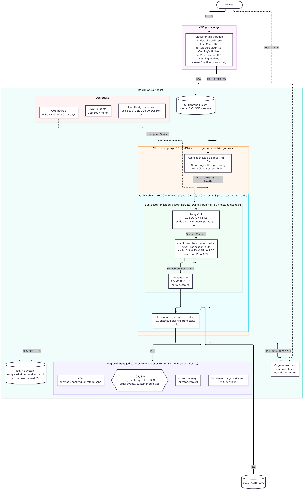
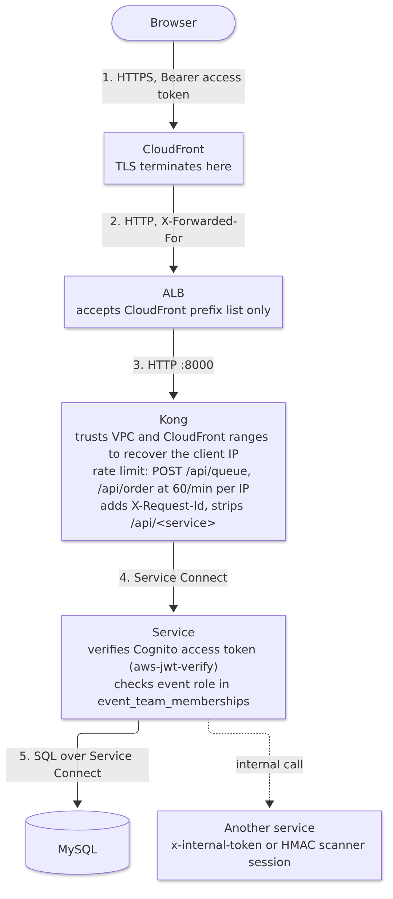

# Physical Architecture and Design

The physical view maps the logical elements onto AWS in region `ap-southeast-1` (Singapore), account `swe5001-project`. Terraform in `backend-repo: infrastructure/terraform` defines everything except the Cognito user pool (AISS-07).

## Key architectural decisions

Table: Physical architectural decisions

| Identifier | Description |
|---|---|
| AD-12 | Run all containers on Amazon ECS with the AWS Fargate launch type, not ECS on EC2 or EKS (ADR-0003, superseding ADR-0001). Trade-off: no host management and per-task isolation against less control over cost per vCPU and warm capacity |
| AD-13 | Run MySQL 8.0 as a single Fargate task whose data lives on encrypted Amazon EFS, backed up daily by AWS Backup, instead of Amazon RDS (ADR-0002). Trade-off: scales to zero and costs little against no managed high availability, point-in-time recovery or engine patching (AISS-02) |
| AD-14 | Serve the SPA and the API from one CloudFront distribution: S3 by default, the ALB for `/api/*`. Trade-off: same-origin (no CORS), TLS at the edge and one URL, against an unencrypted CloudFront-to-ALB hop (AISS-05) |
| AD-15 | Place the ALB and all tasks in two public subnets across two Availability Zones, with an internet gateway and no NAT gateway, restricting traffic with security groups. Trade-off: saves about USD 45/month against tasks having public IP addresses |
| AD-16 | Use Kong Gateway OSS in DB-less mode, as a container behind the ALB, configured from a declarative file. Trade-off: portable, version-controlled gateway with plugins against a redeploy for every config change and per-task rate-limit counters |
| AD-17 | Use ECS Service Connect (namespace `onestage.local`) for discovery and service-to-service traffic, including to MySQL. Trade-off: stable short names and client-side load balancing with no internal load balancer, against a sidecar in every task |
| AD-18 | Scale each service with target tracking: Kong on ALB requests per target (75), the Node services on CPU (60%), scale-out cooldown 60 s and scale-in 300 s, minimum 1 and maximum 3–4 tasks. MySQL is fixed at one task. Trade-off: simple and automatic against reactive lag and targets not yet derived from load tests |
| AD-19 | Use Amazon SQS standard queues with server-side encryption and delivery delays for commands and events. Trade-off: fully managed, cheap and simple against no fan-out and no ordering |
| AD-20 | Use Cognito managed login for identity and verify the access token inside each service with `aws-jwt-verify`, rather than a central auth service. Trade-off: no extra network hop and no auth bottleneck against verification code repeated in every service |
| AD-21 | Send email through Gmail SMTP (port 465) with an app password held in Secrets Manager, instead of Amazon SES. Trade-off: works at once without domain verification or SES sandbox exit, against a personal account's sending limits and deliverability |
| AD-22 | Store event images as `MEDIUMBLOB` in the `events` table and serve them through the event service, instead of in S3. Trade-off: one store, one backup and no extra IAM against larger database rows and uncached image traffic through the API |

### AD-12 ECS on Fargate

**Context.** ADR-0001 chose ECS on EC2 for control over warm capacity and to learn node scaling. Deployment on EC2 failed in a chain of networking problems: EC2 tasks cannot get public IPs, the cheap NAT instance silently did not route because Amazon Linux 2023 has no `iptables`, and small instances ran out of network interfaces without ENI trunking.

**Decision.** Move to Fargate (ADR-0003). Each task is 0.25 vCPU / 0.5 GB, except MySQL at 0.5 vCPU / 1 GB.

**Trade-off.** No hosts to patch, scale or bin-pack, and every task has its own kernel boundary. Fargate costs more per vCPU-hour than well-packed EC2 and has no warm pool, so a new task takes about a minute to start. Scheduled pre-scaling before an announced on-sale is the planned mitigation.

### AD-13 MySQL on Fargate with EFS, not RDS

**Context.** The budget is USD 50/month as a target and USD 100/month as a ceiling, and the whole environment scales to zero outside working hours. RDS cannot scale to zero: a stopped instance restarts after 7 days and storage is billed while stopped. The team saw both effects on a test instance.

**Decision.** `mysql:8.0` as one Fargate task, data on an encrypted EFS file system (bursting throughput) mounted through an access point with TLS in transit, credentials in Secrets Manager, reachable only through Service Connect. AWS Backup snapshots EFS daily at 02:00 SGT and keeps 7 days.

**Trade-off.** Very cheap and scales to zero with everything else. The costs are serious and recorded in AISS-02: one task is a single point of failure (a restart means minutes of downtime), backups are crash-consistent with an RPO of up to 24 hours, there is no point-in-time recovery, and the database is a shared scaling limit. Aurora Serverless v2 or RDS Multi-AZ is the upgrade path.

### AD-14 CloudFront as the single origin

**Decision.** One distribution with two origins. The default behaviour serves the SPA from a private S3 bucket through Origin Access Control, with the managed CachingOptimized policy and a CloudFront Function that rewrites extensionless paths to `index.html`. The `/api/*` behaviour forwards every method to the ALB with caching disabled and all viewer headers except `Host`.

**Trade-off.** Every browser request is same-origin, so Kong needs no CORS plugin and cookies or tokens never cross origins. TLS terminates at the edge with the default `*.cloudfront.net` certificate. The CloudFront-to-ALB hop is plain HTTP inside AWS's network, and there is no custom domain (AISS-05). API responses are not cached at the edge yet, although `GET /events` would benefit from a few seconds of caching.

### AD-15 Public subnets, no NAT gateway

**Decision.** Two public subnets (`10.0.0.0/24` in 1a, `10.0.1.0/24` in 1b). Tasks get public IPs and reach ECR, Secrets Manager, SQS, CloudWatch, Cognito and Gmail through the internet gateway. Security groups enforce the boundaries:

Table: Security groups

| Security group | Ingress | Egress |
|---|---|---|
| `onestage-alb` | TCP 80 from the CloudFront origin-facing prefix list only | TCP 8000 and 8100 to `onestage-ecs-tasks` |
| `onestage-ecs-tasks` | TCP 8000 and 8100 from the ALB; all TCP from itself (Service Connect, MySQL) | All to itself; TCP 443 and 465 to the internet; TCP 2049 to EFS |
| `onestage-efs` | TCP 2049 from `onestage-ecs-tasks` | (default) |

**Trade-off.** Saves the NAT gateway (about USD 45/month, roughly the whole target budget). Tasks have public IPs, so the security group is the only barrier. Several MySQL rules for developers' home IPs were added by hand outside Terraform (`ignore_changes = [ingress]`); this is the most serious open security item (AISS-04). VPC endpoints or a NAT gateway with private subnets is the production design.

### AD-16 Kong DB-less as the API gateway

**Decision.** Kong runs as its own ECS service (1–4 tasks) and is the only target of the ALB, which health-checks Kong's status port 8100. The declarative `kong.yml` defines one route per public service (`/api/<service>`, prefix stripped; the notification service has no route and is reachable only over Service Connect), method-matched write routes for the queue and order services that carry the `rate-limiting` plugin (AD-11), and a global `correlation-id` plugin that adds `X-Request-Id`.

**Alternatives.** ALB path rules cannot rate-limit or add correlation ids. Amazon API Gateway would add per-request cost and a second edge in front of CloudFront.

**Trade-off.** The same gateway config runs in docker-compose and in AWS, and it is reviewed in pull requests. Changing it means rebuilding the Kong image. The `local` rate-limit policy keeps counters per task; a shared Redis would make limits exact at the cost of another component.

### AD-17 ECS Service Connect

**Decision.** Every service, including MySQL, registers in the `onestage.local` HTTP namespace under a short alias (`event`, `queue`, `mysql` and so on). Kong and the services call `http://<alias>:<port>`, and the Service Connect proxy balances across healthy tasks.

**Trade-off.** No internal load balancers and the same host names as docker-compose. Each task carries an Envoy sidecar, which takes part of its 0.5 GB. Kong caching old task addresses after redeployment was one of the issues found during the build.

### AD-18 Target-tracking autoscaling

**Decision.** Application Auto Scaling target tracking on every service except MySQL. Kong scales on `ALBRequestCountPerTarget` (target 75), because it is the front door and CPU lags behind request rate. The Node services scale on average CPU (target 60%). Scale-out cooldown is 60 s and scale-in 300 s ("aggressive up, conservative down").

**Trade-off.** Simple and fully managed. CPU is a lagging signal for I/O-bound services, and the targets were set for the demo rather than measured, so the load test must confirm or replace them. EventBridge Scheduler sets every service to 0 tasks from 02:00 to 18:00 SGT on weekdays to save cost (AD-27).

### AD-19 Amazon SQS standard queues

Table: Queues

| Queue | Producer | Consumer | Delay | Visibility | Retention | DLQ |
|---|---|---|---|---|---|---|
| `onestage-payment-requests` | order API | order worker | 7 s | 60 s | 4 days | `onestage-payment-requests-dlq` after 5 receives, 14 days, CloudWatch alarm |
| `onestage-order-events` | order worker | ticket service | 10 s | 60 s | 4 days | none |
| `onestage-customer-admitted` | queue service | none yet | 0 | 60 s | 4 days | none |

All queues use SQS-managed encryption and 20 s long polling. Each task role may only send to, or receive from, its own queues.

**Trade-off.** No brokers to run and almost no cost at this volume. Standard queues do not guarantee order or exactly-once delivery, which every consumer handles by being idempotent. One queue cannot feed several consumers; adding a second consumer of `OrderPaid` needs SNS or EventBridge fan-out.

### AD-20 Cognito managed login, token verification in each service

**Decision.** The SPA signs users in through Cognito managed login (AWS Amplify) and sends the access token as a Bearer token. Each service verifies the token's signature, issuer, client and `token_use = access` with `aws-jwt-verify`, which caches the user pool's public keys. The event service also calls the Cognito admin API to resolve invitees by email.

**Trade-off.** No auth service on the hot path. Verification code is repeated in every service, and the pool and app client are not in Terraform (AISS-07). The Cognito admin permissions sit on one task role shared by the event, inventory, notification, auth and MySQL tasks, although only the event service needs them, and they include `AdminCreateUser`, which no service uses (AISS-04).

### AD-21 Gmail SMTP for email

**Trade-off.** SES needs a verified domain and a request to leave the sandbox before it can email arbitrary customers; the project has no domain (AISS-05). Gmail worked on day one. It has daily sending limits and weaker deliverability, so SES with a verified domain is the production choice.

### AD-22 Event images in the database

**Trade-off.** One store to back up and secure, and no S3 permissions or signed URLs to manage. Images enlarge the `events` table and travel through Kong and the event service on every view without edge caching. S3 behind the existing CloudFront distribution is the better long-term design.

## Physical detail deployment diagram

Table: ECS services as deployed

| ECS service | Image | Container port | Task size | Tasks (min–max) | Scaling metric | Task role permissions |
|---|---|---|---|---|---|---|
| `onestage-kong` | `onestage-kong` | 8000 (status 8100) | 0.25 vCPU / 0.5 GB | 1–4 | ALB requests per target, 75 | none |
| `onestage-event` | `onestage-backend` | 3001 | 0.25 vCPU / 0.5 GB | 1–3 | CPU 60% | shared role: Cognito `AdminGetUser`, `ListUsers`, `AdminCreateUser` |
| `onestage-inventory` | `onestage-backend` | 3002 | 0.25 vCPU / 0.5 GB | 1–3 | CPU 60% | shared role (as event) |
| `onestage-queue` | `onestage-backend` | 3003 | 0.25 vCPU / 0.5 GB | 1–3 | CPU 60% | send to `customer-admitted` |
| `onestage-order` | `onestage-backend` | 3004 | 0.25 vCPU / 0.5 GB | 1–3 | CPU 60% | send/receive `payment-requests`; send `order-events` |
| `onestage-ticket` | `onestage-backend` | 3005 | 0.25 vCPU / 0.5 GB | 1–3 | CPU 60% | receive `order-events` |
| `onestage-notification` | `onestage-backend` | 3006 | 0.25 vCPU / 0.5 GB | 1–3 | CPU 60% | shared role (as event); SMTP credentials from Secrets Manager |
| `onestage-auth` | `onestage-backend` | 3007 | 0.25 vCPU / 0.5 GB | 1–3 | CPU 60% | shared role (as event) |
| `onestage-mysql` | `mysql:8.0` | 3306 | 0.5 vCPU / 1 GB | 1 (fixed) | none | shared role (as event); EFS access point |

## Technology and services

Table: Technology and cloud services, with rationale and trade-offs

| Area | Choice | Why | Trade-off accepted |
|---|---|---|---|
| Frontend framework | Angular 21 (standalone components, lazy routes) | Team skills; strong typing; built-in router and HTTP client | Larger bundle than lighter frameworks |
| Backend runtime | Node.js 22 (`node:22-alpine`), TypeScript, Express | One language for front and back; fast I/O for many small requests | Single-threaded CPU per task, so scale out rather than up |
| Database driver | `mysql2` connection pools (4–10 connections per task) | Explicit transactions and row locks | Hand-written SQL rather than an ORM |
| Gateway | Kong Gateway OSS 3, DB-less | Declarative, plugins, runs the same locally | Config change needs redeploy |
| Containers | Docker, one backend image plus a Kong image, in Amazon ECR | One build for all services | Every service redeploys on any change |
| Orchestration | Amazon ECS on Fargate, Service Connect | No hosts; native AWS integration | Cold start of about a minute per task |
| Load balancing | Application Load Balancer | Health checks, target tracking metric | Fixed hourly cost even when idle |
| Edge | Amazon CloudFront + S3 (OAC, SSE, versioning) | Global TLS edge, same-origin API | HTTP origin hop; no custom domain |
| Identity | Amazon Cognito managed login | Managed sign-up and sign-in, standard JWTs | Outside Terraform today |
| Messaging | Amazon SQS standard (SSE) | Managed, cheap, DLQ support | No fan-out, no ordering |
| Data | MySQL 8.0 on Fargate + Amazon EFS | Scales to zero; cheap | No managed HA or PITR |
| Secrets | AWS Secrets Manager (one secret, injected as task secrets) | No secrets in images, env files or Terraform state outputs | One secret shared by several services (least privilege gap) |
| Backup | AWS Backup (EFS, daily, 7 days) | Managed schedule and vault | Crash-consistent; RPO up to 24 h |
| Observability | CloudWatch Logs (7-day retention per service), VPC flow logs (90 days), CloudFront and S3 access logs, a read-only role for Grafana Cloud | Low cost, no agents | No dashboard or tracing yet (AISS-10) |
| Cost controls | EventBridge Scheduler (scale to zero), AWS Budgets (USD 100, alerts at 50/80/100/200% and 100% forecast) | Keeps spend inside the course budget | Environment unavailable on weekday daytime |
| Infrastructure as code | Terraform 1.x, AWS provider 6, S3 backend with lock file | Reviewable, repeatable infrastructure | Manual apply; console edits cause drift |
| CI/CD | GitHub Actions with OIDC roles | No long-lived AWS keys | Single environment |
