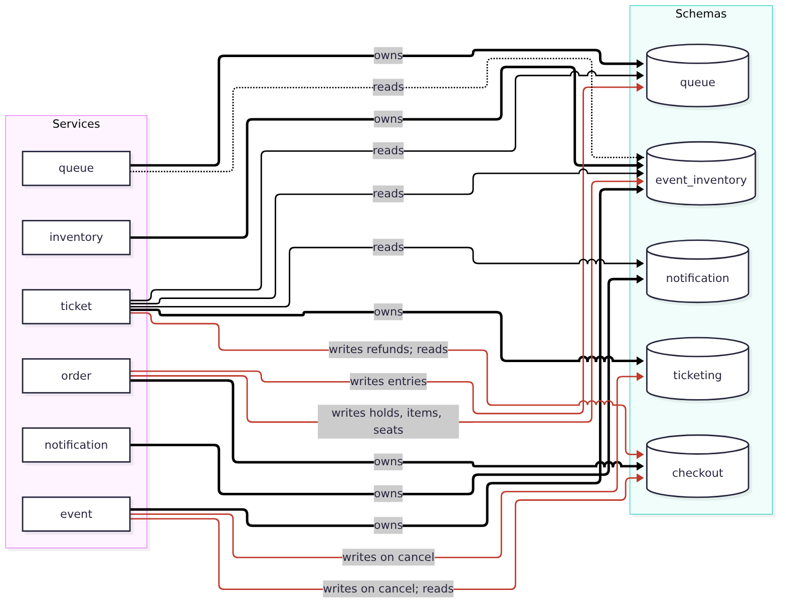

# Persistence Design

All durable business data lives in one MySQL 8.0 server (InnoDB, `utf8mb4`, UTC timestamps) with one schema per bounded context. Messages in flight live in SQS. Logs live in CloudWatch Logs and S3. The SPA keeps only the user's tokens, a pending order id and the ids of events whose queues the user is in (never admission tokens) in browser storage.

## Schemas and ownership

Table: Schemas

| Schema | Owning service(s) | Tables | Purpose |
|---|---|---|---|
| `event_inventory` | event, inventory | `events`, `event_team_memberships`, `inventory_items`, `seats`, `inventory_holds`, `event_grid_settings` | Events, teams, sellable inventory and holds |
| `queue` | queue | `queue_sessions`, `queue_entries` | One queue per event, for both tiers |
| `checkout` | order | `orders`, `order_items`, `payments` | Orders and mock payments |
| `ticketing` | ticket | `tickets`, `check_in_logs`, `ga_section_counters` | Tickets, general-admission section numbering and every scan attempt |
| `notification` | notification | `email_notifications` | Email delivery records |

Every service connects as the same database user (`onestage_app`), which has full privileges on all five schemas. Ownership is a code convention, not a database permission (AISS-01).

**Foreign keys.** Tables inside a schema use real foreign keys. A reference to another schema's row (for example `checkout.orders.hold_id` or `ticketing.tickets.order_id`) is a plain indexed column with no foreign key. This keeps each schema movable to its own server later.

**Identifiers.** All primary keys are `BIGINT UNSIGNED AUTO_INCREMENT`. Users are referenced by their Cognito `sub`. Email addresses and names are copied from the token at write time, so rendering an order or ticket never needs a call to another service.

## Logical data model

The diagrams below are drawn from the live migrations `02` to `19` in `backend-repo: database/`.

**Stage pieces.** The seat-map editor stores the stage as up to five rows in `inventory_items` named `__STAGE__`, with zero capacity and price. Services that list zones filter them out by name (AISS-17).

### Cross-schema access

Table: Cross-schema access found in the service code

| Service | Writes outside its own schema | Reads outside its own schema | Why |
|---|---|---|---|
| order | `event_inventory.inventory_holds`, `inventory_items`, `seats`; `queue.queue_entries` | `event_inventory.events`, `event_team_memberships`; `queue.queue_sessions` | Reserve-and-order and capture in one transaction (AD-04) |
| event | `ticketing.tickets` (void), `checkout.orders` (refund) | `checkout.orders`, `order_items` | Event cancellation in one transaction |
| ticket | `checkout.orders` (refund during cancellation sweep) | `checkout.orders`, `order_items`; `event_inventory.*`; `queue.*`; `notification.email_notifications` | Issuance, attendee views, sales summary, staff checks, reconciliation |
| queue | none | `event_inventory.events`, `inventory_items`, `seats`, `event_team_memberships` | Availability for batch sizing; organiser check |
| inventory, notification | none | none | |

## Transactions and concurrency

The database runs at InnoDB's default isolation level, `REPEATABLE READ`. Correctness does not rely on the isolation level: every write path that can race takes explicit row locks with `SELECT ... FOR UPDATE` before deciding anything.

Table: Concurrency control on the write paths that can race

| Operation | Service | Rows locked (in order) | Guard against races |
|---|---|---|---|
| Reserve and create order, Tier 2 | order | queue entry (admission token); seats in `seat_id` order | Token must be live, else 403; all requested seats must be `AVAILABLE` under the lock, else 409 |
| Reserve and create order, Tier 1 | order | queue entry (admission token); all inventory items of the event | Token must be live, else 403; picks the chosen section or one with enough capacity; `CHECK (reserved_qty + sold_qty <= total_qty)` |
| Reserve with an existing hold | order | the hold | Owner check; hold must be `ACTIVE` and unexpired; one order per hold (`uq_orders_hold`) |
| Capture payment | order worker | order, then hold | `PAID` orders are not captured again; seat or quantity updates must change exactly the expected number of rows, else roll back |
| Expire reservations | order | pending orders joined to active expired holds | Runs before each order creation for that event |
| Join queue | queue | queue session (created on the first join) | One session per event (`ON DUPLICATE KEY` on the unique event id); one entry per customer (`uq_queue_customer`); positions assigned under the session lock |
| Admit next batch | queue | queue session, then the next `WAITING` entries in position order | Serialises the scheduler across replicas; batch bounded by buyer cap and seats left |
| Issue tickets | ticket | named lock `ticket-order-<id>`, then the order's existing tickets, then each general-admission section's counter in `inventory_item_id` order | Inserts only missing tickets per order item; section numbers come from the locked counter, so they are unique (`uq_ticket_section_seat`) and a rollback returns them |
| Check in | ticket | the ticket | Only `ISSUED` becomes `CHECKED_IN`; every attempt logged |
| Edit seat | inventory | the seat | Cannot change a held or sold seat |
| Reconfigure inventory | inventory | the event's items and non-available seats | Cannot shrink below what is reserved or sold; seated maps capped at 400 seats (AISS-15) |
| Change a draft's tier | event | the event, its items and holds | Refused if anything is reserved or sold; otherwise the old seats, zones, stage and grid are deleted in the same transaction |
| Cancel or publish event | event | the event | Cancel and publish cannot interleave |

**Deadlock avoidance.** Seats are always locked in ascending `seat_id`, and multi-table transactions lock the parent row (session, order, event) before child rows. MySQL detects any remaining deadlock and rolls back one transaction, which the service reports as an error the client can retry.

**Optimistic counters.** `inventory_items.version` is incremented on every change. It is not used for compare-and-set today, because pessimistic locks already serialise writers; it is kept for change detection.

**Connection pools.** Each task has a small pool: event and inventory 4 connections, queue, order and ticket 8, notification 10. At maximum scale (3 tasks per service) the services can open at most 3 × (4 + 4 + 8 + 8 + 8 + 10) = 126 connections, just below MySQL's default `max_connections` of 151. Raising the task maximums would need a larger MySQL limit or a connection proxy.

## How long data persists

Table: Persistence and retention

| Data | Store | Persists beyond the request? | Retention today |
|---|---|---|---|
| Events, inventory, seats, teams | MySQL | Yes | Indefinite. Draft events can be deleted; published and cancelled events are kept |
| Holds | MySQL | Yes | Indefinite. Expire after 3 minutes but stay as `EXPIRED`, `RELEASED` or `CONFIRMED` rows |
| Queue entries | MySQL | Yes | Indefinite. Admission tokens are cleared when they expire or are used |
| Orders, order items, payments | MySQL | Yes | Indefinite (financial record) |
| Tickets and check-in logs | MySQL | Yes | Indefinite (audit record of entry) |
| Email notification records | MySQL | Yes | Indefinite |
| Commands and events in flight | SQS | Until consumed | 4 days; DLQ 14 days |
| Database backups | AWS Backup (EFS) | Yes | 7 days, daily |
| Service logs | CloudWatch Logs | Yes | 7 days |
| VPC flow logs | CloudWatch Logs | Yes | 90 days |
| CloudFront and S3 access logs | S3 | Yes | 30 days |
| SPA build artefacts | S3 (versioned) | Yes | All versions kept |
| Tokens and pending order id | Browser storage | Session | Until sign-out or expiry |

No retention policy deletes personal data from MySQL yet. A production deployment would need one (for example removing personal details from orders and tickets a set time after the event), and it is recorded under AISS-02.

## Information architecture: data groups

### Identity and personal data

**Data format.** Cognito holds the user profile (email, name, password hash, `sub`). Copies of email and name are stored as columns in `event_team_memberships`, `orders`, `tickets` and `email_notifications`.

**Proposed storage technology.** Amazon Cognito as the system of record; MySQL rows for the copies.

**Security requirements and controls.** Personal data must be visible only to the person and to that event's staff. Controls: Cognito-managed credentials; access tokens verified in every service; event-role checks before organisers or helpers can list attendees; EFS encryption at rest (AWS KMS) and TLS to EFS; database reachable only inside the VPC security group (but see AISS-04); logs record ids, not emails, on the payment path.

**Trade-off consideration.** Copying email and name avoids a call to Cognito on every page, at the cost of copies going stale if a user changes their email. The team accepted stale copies because a ticket should keep the details used at purchase time.

### Transactional data (orders, holds, payments)

**Data format.** Relational rows with enumerated statuses and integer money in cents (`SGD`).

**Proposed storage technology.** MySQL InnoDB, because the no-oversell guarantee needs ACID transactions and row locks across inventory and orders.

**Security requirements and controls.** Integrity is the main requirement. Controls: one transaction per state change; row locks; `CHECK` constraints; unique keys (`uq_orders_hold`); ownership checks on every customer endpoint. Payment uses tokenisation: only the fixed mock token `simulated` is accepted on the asynchronous path, so no card number, CVC or expiry is ever stored, queued or logged. The older synchronous endpoint (kept for compatibility, no longer used by the SPA) stores whatever token string the client sends, up to 255 characters, in `payments.payment_token`.

**Trade-off consideration.** A relational store is harder to scale out than a key-value store. The waiting room caps how much load reaches it, and the team chose correctness over write scalability.

### Tickets and QR tokens

**Data format.** One row per ticket with a 32-byte random token (base64url) encoded in the QR code. The QR image is generated when needed and is not stored.

**Proposed storage technology.** MySQL (`ticketing.tickets`), with a unique index on `qr_token`.

**Security requirements and controls.** Tokens must be unguessable and usable once. Controls: cryptographically random tokens; check-in only by staff holding an event-scoped scanner session (HMAC-SHA256 signed, short-lived); `SELECT ... FOR UPDATE` so a ticket is checked in once; `VOID` status on cancellation; every attempt logged with the scanner's identity.

**Trade-off consideration.** A random token needs a database lookup at the door. A signed token could be checked offline, but could not be revoked when an event is cancelled. Revocation and duplicate detection matter more.

### Audit data (check-in logs, team memberships, notification records)

**Data format.** Append-only rows: `check_in_logs` records every scan with the result and the scanner's `sub`; `email_notifications` records every delivery attempt.

**Proposed storage technology.** MySQL, next to the data they describe, so they are written in the same transaction.

**Security requirements and controls.** Logs must not be editable by users; no endpoint updates or deletes them. Removing a team member keeps the row as `REVOKED` with `revoked_at` and `revoked_by_sub`, so past access stays on record (AISS-13, in testing).

**Trade-off consideration.** Keeping audit rows in the operational database is simple and transactional, but they grow without bound and share the database's single point of failure.

### Media (event images)

**Data format.** Binary image (`MEDIUMBLOB`, up to 16 MB) with its MIME type, in `event_inventory.events`.

**Proposed storage technology.** MySQL today (AD-22); S3 behind CloudFront is the target.

**Security requirements and controls.** Public once the event is published. Only organisers can upload. The event service sets the content type on the response.

**Trade-off consideration.** One store to back up against larger rows, a bigger backup and uncached image traffic through the API.

### Secrets and configuration

**Data format.** One JSON secret (`onestage/mysql`) holding database passwords, the internal API token, the scanner session secret and SMTP credentials. Non-secret configuration is passed as environment variables.

**Proposed storage technology.** AWS Secrets Manager; Terraform generates random values and ignores later changes, so rotated values are not overwritten.

**Security requirements and controls.** Secrets are injected into tasks at start by the execution role; they are never in images, git or logs. Gap: every service that needs any value can read the whole secret; separate secrets per purpose would follow least privilege.

## Backup, recovery and schema changes

- **Backup.** AWS Backup takes a daily snapshot of the EFS file system at 02:00 SGT and keeps it 7 days. Snapshots are crash-consistent (InnoDB recovers on start), not application-consistent.
- **Recovery objectives.** RPO up to 24 hours. RTO is the time to restore EFS and start the MySQL task, not yet measured. Both are recorded in AISS-02.
- **Schema changes.** Numbered SQL migrations (`02` to `16`) applied in order. Recent migrations check `information_schema` first, so running them twice is safe. Migration `12` has a rollback script. Changes are additive (expand and contract) so the old and new service versions can run side by side during a rolling deployment.
