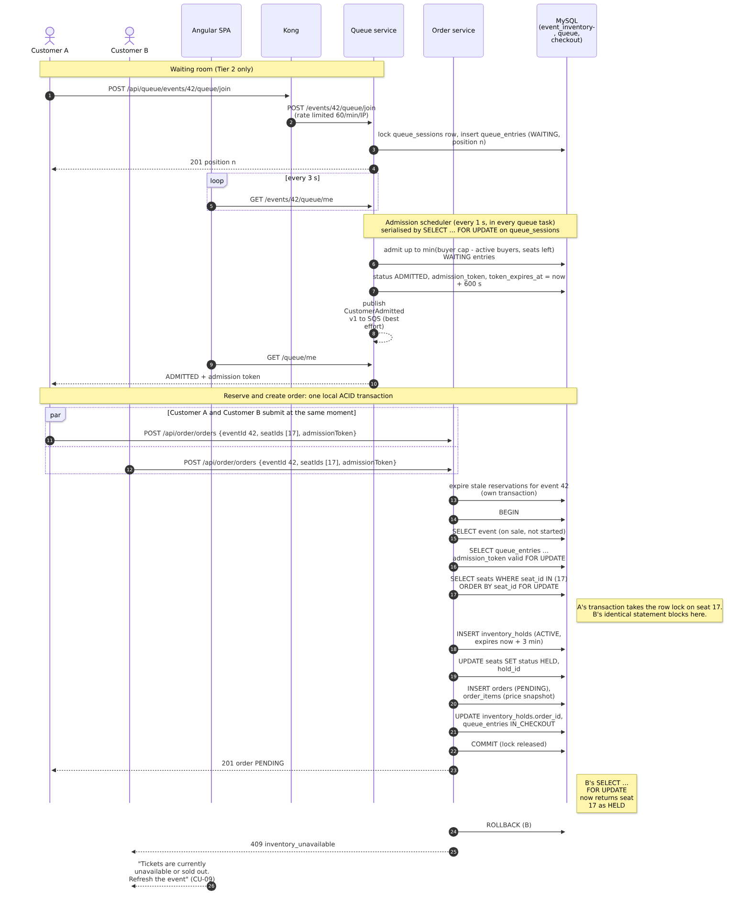
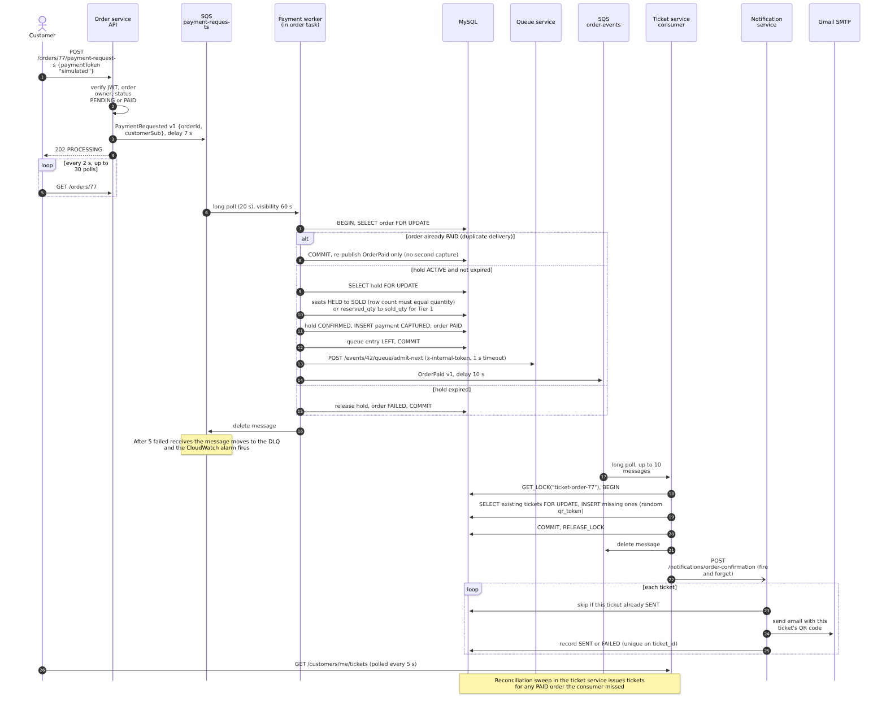
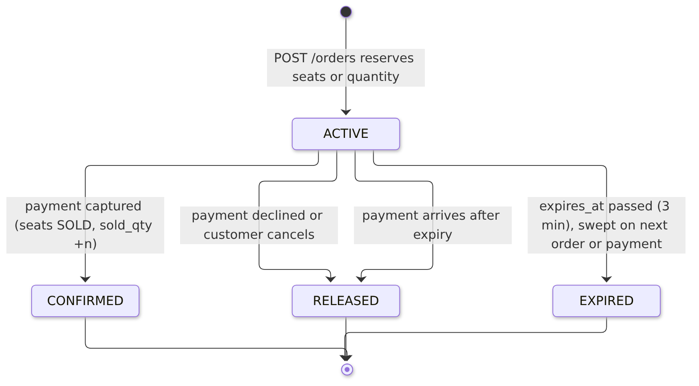
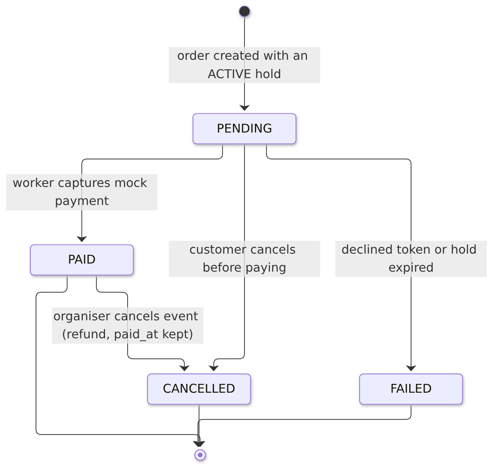
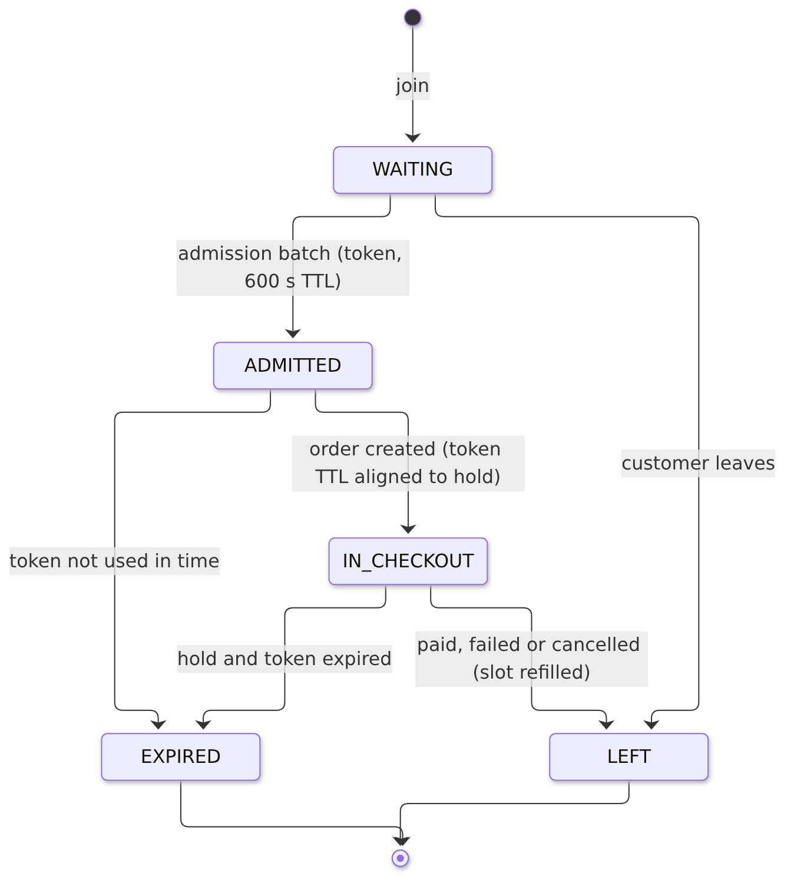
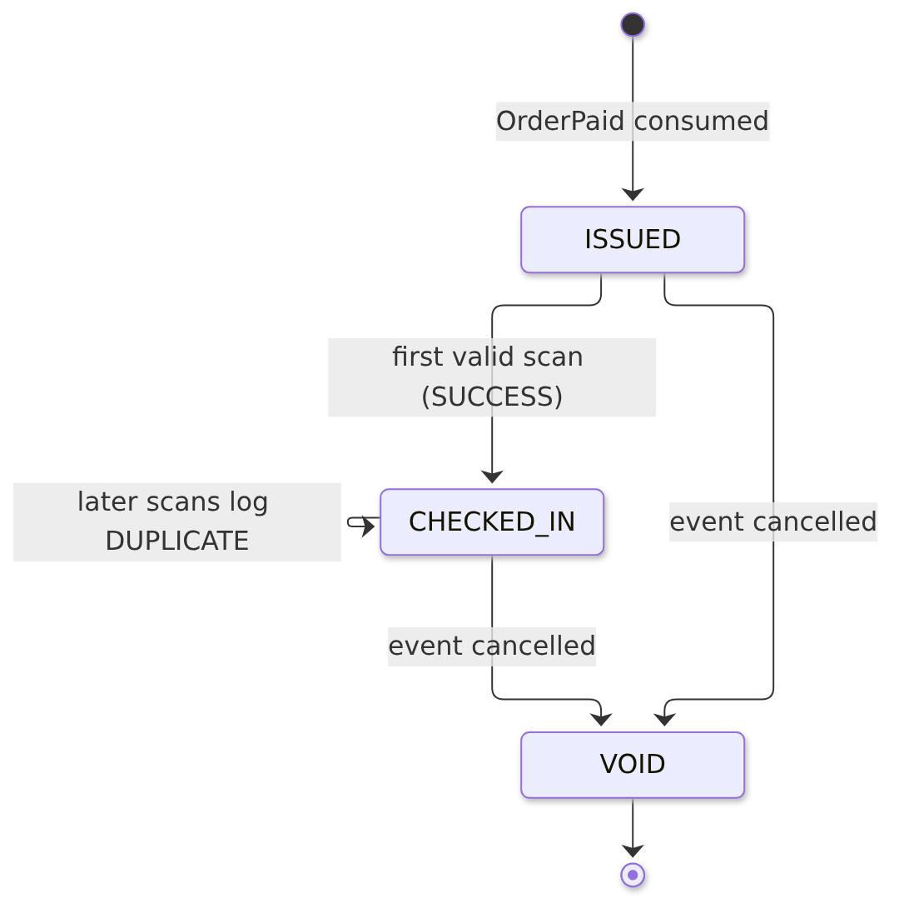
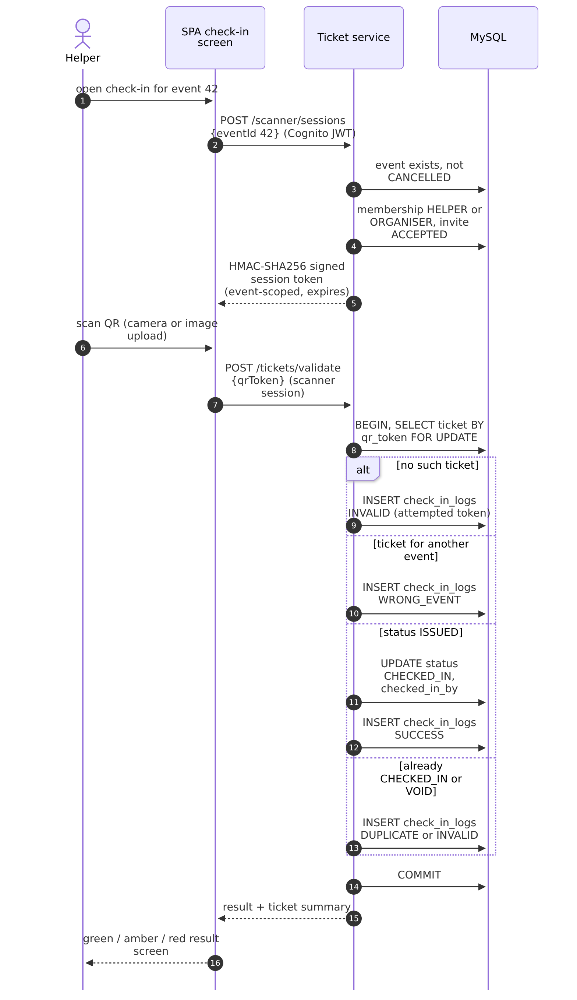

# Detailed Design

This section shows the detailed design of the use case that best represents the architecture: **a Tier 2 (seated) purchase under contention**, covering CU-04 (join the waiting room), CU-03 (select seats), CU-06 (checkout), CU-07 (QR e-ticket) and CU-09 (conflict feedback, no double sale). It exercises almost every architectural decision: the waiting room (AD-03), the lock-based no-oversell transaction (AD-02, AD-04), the asynchronous payment (AD-05), ticket choreography (AD-06), email isolation (AD-09), co-located workers (AD-10) and rate limiting (AD-11).

A shorter second use case, door check-in (EH-01 to EH-04), follows at the end.

## Use case: Tier 2 purchase under contention

### Step 1: waiting room and admission

A customer opens a published Tier 2 event and joins its queue. The queue service locks the event's queue session row, gives the customer the next position and stores a `WAITING` entry. The SPA polls `GET /queue/me` every 3 seconds.

The admission scheduler runs every second in every queue task. For each open session with waiting customers whose admission interval has passed, it calls `admitNextBatch` in one transaction:

1. Lock the queue session row (`SELECT ... FOR UPDATE`). Only one replica can admit for an event at a time.
2. Read the seats still `AVAILABLE` from `event_inventory`. If none are left, mark the session `DRAINED` and stop.
3. Expire admitted entries whose token has lapsed, which frees their slots.
4. Compute the batch: `min(buyer cap − buyers currently ADMITTED or IN_CHECKOUT, seats available)`. The buyer cap is the event's `available_buyers`, or 10% of total seats (minimum 1) if not set.
5. Lock that many `WAITING` entries in position order and mark each `ADMITTED` with a fresh 32-byte random token valid for 600 seconds.
6. Commit, then publish one `CustomerAdmitted` v1 message per admitted customer. A failed publish is logged and does not undo the admission.

The SPA's next poll returns `ADMITTED` and the token.

### Step 2: reserve seats and create the order

The customer picks seats on the seat map and the SPA sends `POST /api/order/orders` with the event id, the seat ids, the quantity and the admission token. Kong counts the request against the client's 60 writes per minute and forwards it to the order service.

The order service first expires stale reservations for the event in a short transaction of its own. Then it opens **one transaction** that covers three schemas:

Table: The reserve-and-order transaction (order service, `POST /orders`)

| Order | Statement | Purpose |
|---|---|---|
| 1 | `SELECT ... FROM event_inventory.events` | The event exists, is `PUBLISHED` and has not started |
| 2 | `SELECT ... FROM queue.queue_entries ... admission_token = ? AND token_expires_at > now FOR UPDATE` | The caller was admitted and the token is still valid |
| 3 | `SELECT ... FROM event_inventory.seats WHERE seat_id IN (...) ORDER BY seat_id FOR UPDATE` | Lock the requested seats in a fixed order |
| 4 | Check every seat is `AVAILABLE`; otherwise roll back and answer `409 inventory_unavailable` | The no-oversell decision, made while holding the locks |
| 5 | `INSERT INTO event_inventory.inventory_holds` (status `ACTIVE`, expires in 3 minutes) | The reservation |
| 6 | `UPDATE event_inventory.seats SET status = 'HELD', hold_id = ?` | Seats are visibly taken |
| 7 | `INSERT INTO checkout.orders` (`PENDING`), `INSERT INTO checkout.order_items` | Order with price and description copied at this moment |
| 8 | `UPDATE event_inventory.inventory_holds SET order_id = ?` | Link the hold to its order (one order per hold) |
| 9 | `UPDATE queue.queue_entries SET status = 'IN_CHECKOUT', token_expires_at = hold.expires_at` | The buyer keeps their slot only as long as their hold |
| 10 | `COMMIT` | All of the above become visible at once, or none of it does |

**What happens under contention.** When customers A and B ask for seat 17 at the same moment, both transactions reach step 3. InnoDB grants the row lock on seat 17 to one of them (A). B's `SELECT ... FOR UPDATE` waits. A inserts the hold, marks the seat `HELD` and commits, which releases the lock. B's statement then returns seat 17 as `HELD`, so B fails the check in step 4, rolls back and receives `409 inventory_unavailable`. The SPA shows *"Tickets are currently unavailable or sold out. Refresh the event before trying again."* No seat can be held twice, because the check and the update happen under the same lock.

Because seats are always locked in ascending `seat_id`, two customers requesting overlapping sets of seats (for example A wants 17 and 18, B wants 18 and 17) cannot deadlock: both wait on seat 17 first.

**Tier 1 variant.** For a general-admission event there is no queue and no seat map. Step 3 locks all inventory items (zones) of the event, picks one with enough remaining capacity and increments `reserved_qty`. The database's `CHECK (reserved_qty + sold_qty <= total_qty)` rejects any update that would oversell, even if the code had a bug.

### Step 3: asynchronous payment

The customer confirms the mock payment. The SPA sends `POST /orders/{id}/payment-requests` with the token `simulated`. The order service checks the caller owns the order and that it is `PENDING` or `PAID`, sends `PaymentRequested` to `payment-requests` with a 7-second delay and answers `202 PROCESSING`. The SPA polls `GET /orders/{id}` every 2 seconds, up to 30 times, and keeps the order id in session storage so a page refresh resumes polling.

The payment worker inside the order task long-polls the queue and runs `processPayment` in one transaction:

1. Lock the order row. If it is already `PAID`, this is a duplicate delivery: commit, publish `OrderPaid` again and stop. No second capture is possible.
2. Lock the hold. If it is no longer `ACTIVE` or has expired, release it (seats back to `AVAILABLE`), mark the order `FAILED`, release the queue slot and commit.
3. Otherwise mark the held seats `SOLD`. The update must change exactly `quantity` rows, or the transaction rolls back. For Tier 1, move `quantity` from `reserved_qty` to `sold_qty`.
4. Mark the hold `CONFIRMED`, insert a `CAPTURED` payment, mark the order `PAID` and mark the queue entry `LEFT`.
5. Commit. Then ask the queue service to admit the next buyer into the freed slot (`POST /queue/admit-next` with the internal token and a 1-second timeout; the scheduler is the fallback), and publish `OrderPaid` to `order-events` with a 10-second delay.

If processing throws, the message becomes visible again after 60 seconds. After five failed receives it moves to the dead-letter queue and a CloudWatch alarm fires.

### Step 4: ticket issuance and email

The ticket service long-polls `order-events`. For each `OrderPaid` it takes a named lock for the order, counts tickets already issued per order item, inserts the missing ones with random QR tokens and commits. Only then does it delete the message and, without waiting, ask the notification service to email the tickets. The notification service sends one email per ticket and records each outcome, skipping tickets already `SENT`.

The SPA polls `GET /customers/me/tickets` every 5 seconds and shows the QR codes when they exist. A reconciliation sweep in the ticket service issues tickets for any paid order whose message was lost.

### State models

The use case moves four entities through their lifecycles. Each transition happens inside one of the transactions above.

### Failure handling

Table: What happens when something fails during a purchase

| Failure | Effect | Recovery |
|---|---|---|
| Two buyers want the same seat | The second waits for the row lock, then gets 409 | The buyer picks other seats |
| Buyer abandons checkout | Hold expires after 3 minutes | Next order or payment for the event releases it; the queue slot is freed |
| Admission token expires before ordering | Order is refused with 403 | The buyer rejoins the queue |
| Payment message delivered twice | Second delivery finds the order `PAID` | Republishes `OrderPaid`; no second capture |
| Payment arrives after the hold expired | Order marked `FAILED`, seats released | The buyer starts again |
| Payment worker crashes mid-transaction | Transaction rolls back; message reappears after 60 s | Retried up to 5 times, then the DLQ and its alarm |
| Queue refill call fails or times out | Logged; payment still succeeds | The admission scheduler admits within about a second |
| `OrderPaid` delivered twice | Issuance finds tickets already exist | Inserts nothing new |
| Ticket consumer down | Messages wait in `order-events` (4 days) | Consumed on restart; reconciliation sweep as backstop |
| SMTP fails | Notification recorded as `FAILED`; tickets still visible in the SPA | A retried call resends only failed tickets |
| Database task restarts | All writes fail until it is back (minutes) | ECS restarts the task; in-flight transactions roll back; SQS retries (AISS-02) |

### Main code elements

Table: Where the use case is implemented

| Element | Location | Responsibility |
|---|---|---|
| `POST /events/:eventId/queue/join`, `GET /events/:eventId/queue/me` | `backend-repo: services/queue/src/index.ts` | Join and poll the waiting room |
| `admitNextBatch`, `runAdmissionSweep`, `availableAdmissionSlots` | same | Admission scheduler and batch sizing |
| `POST /orders`, `expireReservations`, `selectAvailableZone` | `backend-repo: services/order/src/index.ts` | Reserve-and-order transaction |
| `POST /orders/:orderId/payment-requests`, `processPayment`, `publishOrderPaid`, `requestQueueRefill` | same | Payment request, capture, follow-up |
| `enqueuePayment`, `consumePayments` | `backend-repo: services/order/src/payment-queue.ts` | SQS send and long-poll worker |
| `consumeOrderPaidEvents`, `issueTickets`, `reconcilePaidOrders` | `backend-repo: services/ticket/src/index.ts` | Idempotent issuance and safety net |
| `POST /notifications/order-confirmation` | `backend-repo: services/notification/src/app.ts` | Per-ticket email with delivery record |
| Event detail, seat map, queue and checkout screens | `core-frontend: src/app/events/`, `src/app/checkout/`, `src/app/core/queue.ts`, `src/app/core/payment-processing.ts` | Client side of the flow |

## Use case: door check-in

A helper opens check-in for an event. The ticket service confirms the event is not cancelled and that the helper has an accepted Helper or Organiser membership, then issues a scanner session: an HMAC-SHA256 signed token naming the helper, the event and an expiry. Each scan sends the QR token with that session. In one transaction the service locks the ticket row, decides the result and logs the attempt:

Table: Check-in outcomes

| Ticket state | Result shown | Ticket change |
|---|---|---|
| Not found | `INVALID` (red) | none; the attempted token is logged |
| Belongs to another event | `WRONG_EVENT` (red) | none |
| `ISSUED` | `SUCCESS` (green) | becomes `CHECKED_IN` with time and helper |
| `CHECKED_IN` | `DUPLICATE` (amber) | none |
| `VOID` (event cancelled) | `INVALID` (red) | none |

Because the ticket row is locked, two helpers scanning the same ticket at two doors at once get one `SUCCESS` and one `DUPLICATE` (EH-04). The session token limits a helper to the event they are staffing, so a leaked session cannot check in tickets for another event.
