# OneStage — BCE Sequence Diagrams

> **Archived: original design, August 2026.** This document records the design as first planned. The system as built differs in several ways (see `architecture/00-overview.md`, "Original design versus the system as built"). For the current design, read `architecture/`. Kept unchanged below as a historical record.

*SWE5001 · Architecting Scalable Systems · Graduate Certificate, NUS–ISS*

Boundary–Control–Entity sequence diagrams for all 27 user stories, showing exactly which screen, service, and domain object handles each step. Control objects are the service façades and Entity objects are the domain classes from the *System Design* doc; the stories themselves are in *User Stories & Use-Case Diagrams*.

27 sequence diagrams · 3 personas · Boundary → Control → Entity

## Reading a BCE sequence diagram

Every diagram in this document follows the same strict layering. Columns run left to right in this order, and a message never skips a layer — a Boundary talks only to a Control, a Control talks only to Entities (or to another Control, when a step needs to call across services), and an Entity never talks to a Boundary directly.

| Layer | What it is here | Examples in this document |
|---|---|---|
| Actor | A human role interacting with the system. | Customer, Event Organiser, Event Helper |
| Boundary | The UI screen, form, or gateway the actor touches directly — one per buyer/organizer/scanner app screen. | `SeatSelectionScreen`, `TeamManagementScreen`, `ScanScreen` |
| Control | A service façade — the same four classes defined in the System Design doc's class diagrams, each owning one schema. | `EventInventoryService`, `WaitingRoomService`, `CheckoutService`, `TicketService` |
| Entity | A domain object — the same classes defined in the System Design doc's ERDs/class diagrams, each backed by a table in its service's schema. | `Event`, `InventoryHold`, `EventTeamMembership`, `Order`, `Ticket`… |

A few conventions worth flagging before the diagrams themselves:

| Pattern | What it means |
|---|---|
| Control→Control | A cross-service call, e.g. `CheckoutService→EventInventoryService` to confirm a hold. This is the one deliberate exception to strict layering — services still only reach each other's Control layer, never another service's Entities directly. |
| SQS actor | Drawn as a participant, not an actor, at the far left of an async diagram (e.g. CU-07) — it delivers a message with no human triggering that step. |
| `alt / else` | A branch with mutually exclusive outcomes — typically a validation success/failure split. |
| `opt` | A step that only happens under one condition and is otherwise skipped entirely — almost always the Tier 1/Tier 2 branch. |
| `loop` | Polling from a Boundary while state hasn't changed yet (queue position, check-in counters). |
| `par` | Two independent reads issued together because they hit different services with nothing to synchronize. |

Class and attribute names match the System Design doc exactly, so a name in a sequence diagram here can always be traced back to a field or method on the same-named class there.

## Customer (9)

### CU-01 — Browse & Search Events

A read-only query against published events — the simplest shape in the set: Boundary asks Control, Control asks Entity, results flow straight back.

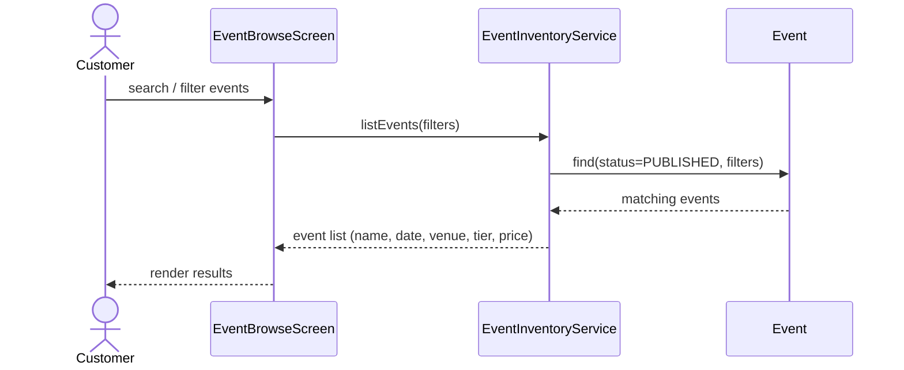

### CU-02 — View Event Details

Availability is sourced differently by tier: a GA quantity from InventoryItem, or a live seat map from Seat — the Control layer hides that branch from the screen.

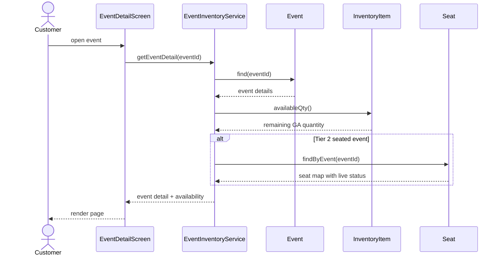

### CU-03 — Select Tickets / Seats

The concurrency-safe reservation itself: InventoryItem.reserve() is the one call that must never let reserved+sold exceed total, so its failure path is drawn out in full.

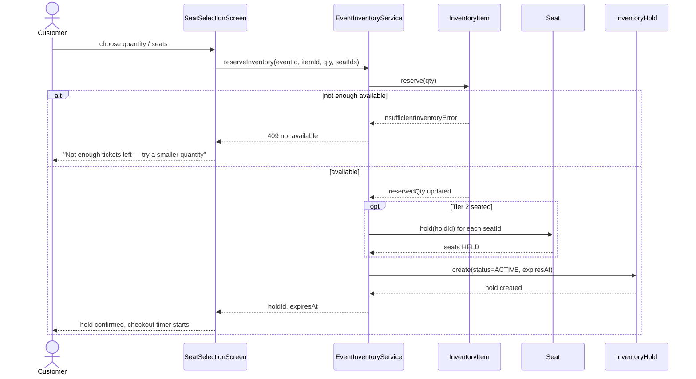

### CU-04 — Join the Waiting Room

Joining is a single write — a QueueEntry row at the next position — gated on the QueueSession actually being open for admission.

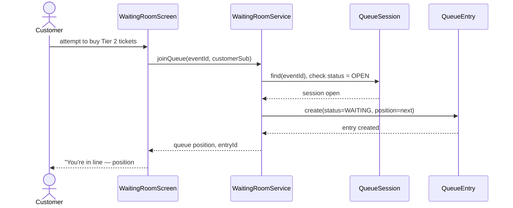

### CU-05 — See Live Queue Status

A polling loop until the admission worker (elsewhere) flips the entry to ADMITTED — the screen never gets pushed to, it just keeps asking.

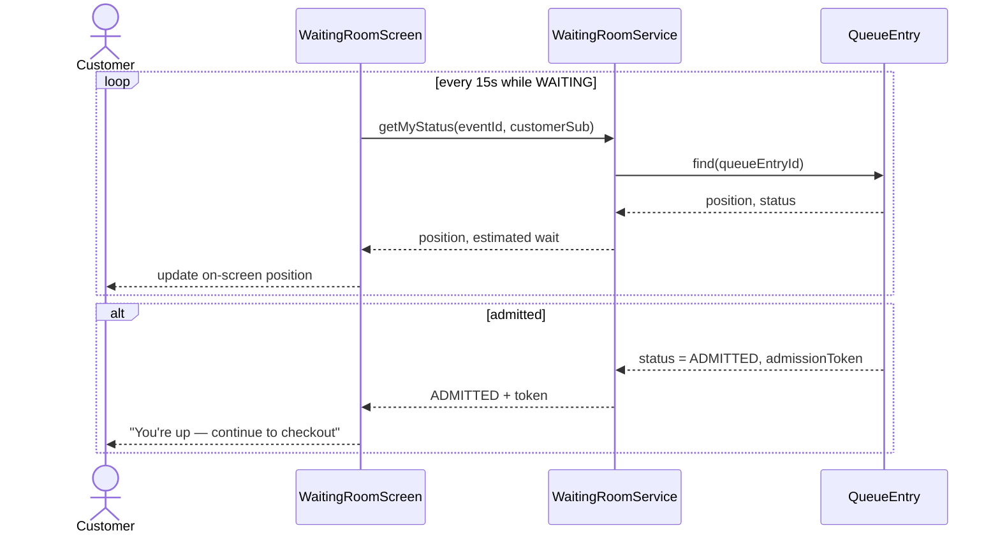

### CU-06 — Checkout (Simulated Payment)

The whole point of the sync/async split: confirming the hold happens inside the same call that marks the order PAID, before OrderPaid is ever published.

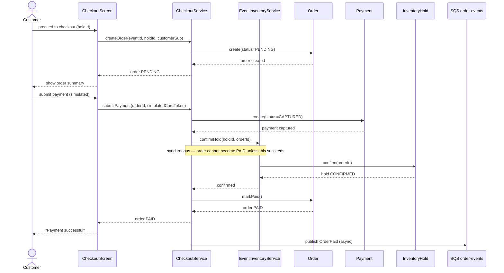

### CU-07 — Receive QR E-Ticket

No actor action starts this one — it begins with the SQS message from CU-06, which is exactly the point: ticket issuance is decoupled from the checkout response.

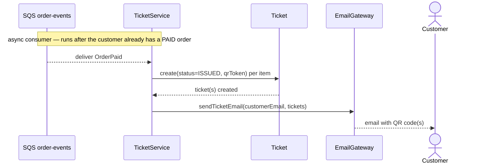

### CU-08 — View My Tickets & Orders

Two independent reads — order history from Checkout, ticket/QR state from Ticketing — assembled on one screen without either service knowing about the other.

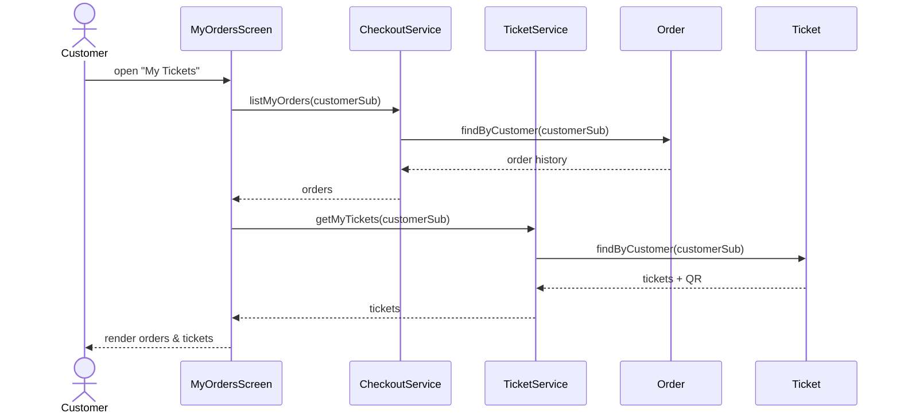

### CU-09 — Sold-Out / Conflict Feedback

The failure twin of CU-06: the same confirmHold() call, but the hold has expired or was already confirmed — the order fails cleanly instead of silently overselling.

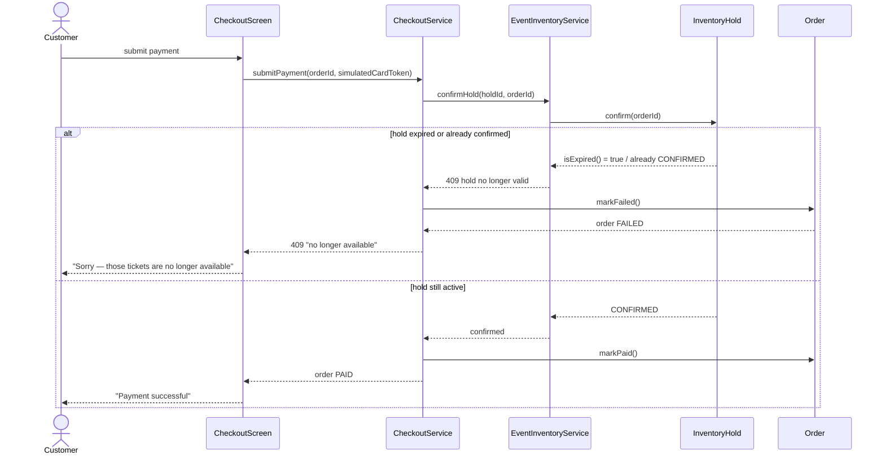

## Event Organiser / Admin (12)

### OR-01 — Sign In to Portal

Deliberately thin: authentication itself is Cognito's job, not ours, so this diagram stops at the JWT handoff rather than modeling a login control/entity that doesn't exist.

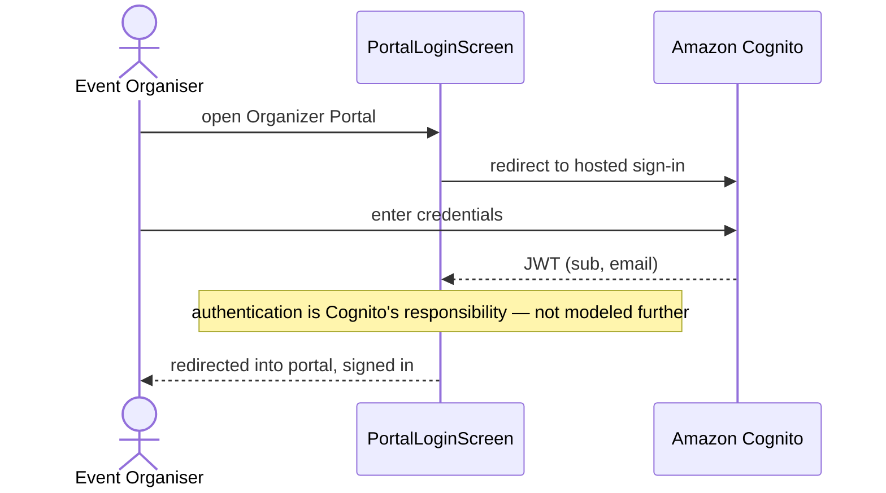

### OR-02 — Create Event (Tier 1 / Tier 2)

Creating an event and staffing it with its first Organiser happen in the same control call — the creator never has to be separately "added" to their own event.

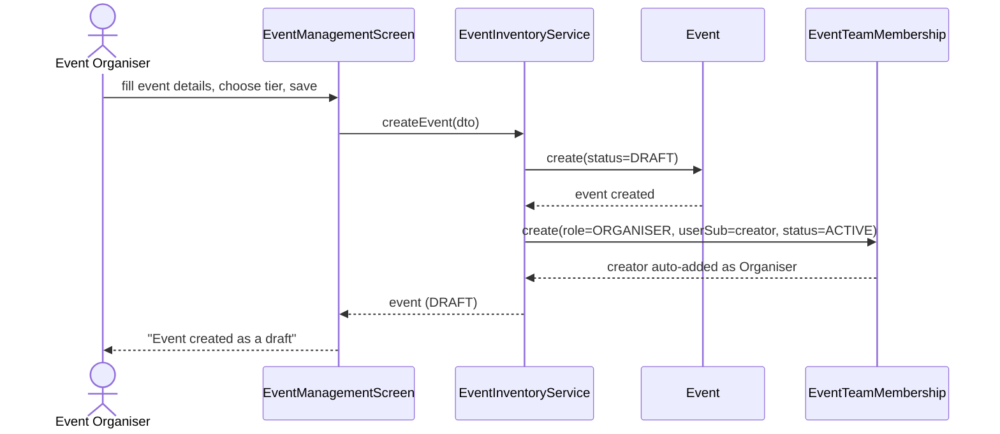

### OR-03 — Configure Inventory

One form, two outcomes: Tier 1 only touches the InventoryItem counters, Tier 2 additionally bulk-creates the individual Seat rows the seat map depends on.

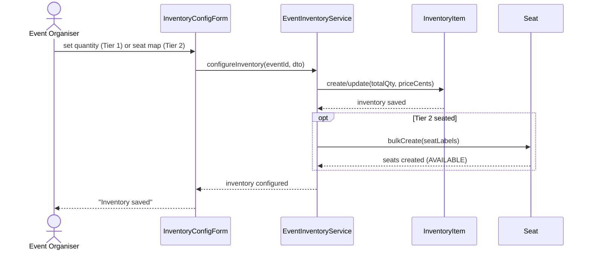

### OR-04 — Configure the Waiting Room

A straight write to QueueSession — this is the entity that CU-04/CU-05 read from, and it has nowhere to live if this configuration step doesn't exist.

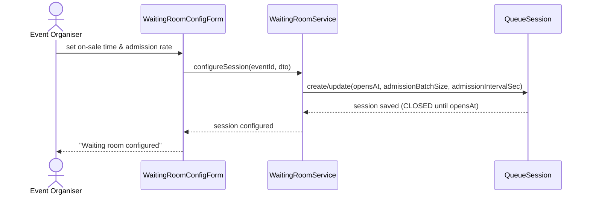

### OR-05 — Publish Event

Publish is a state transition guarded by the Event entity itself — the Control layer doesn't duplicate the validation, it just relays whatever Event.publish() decides.

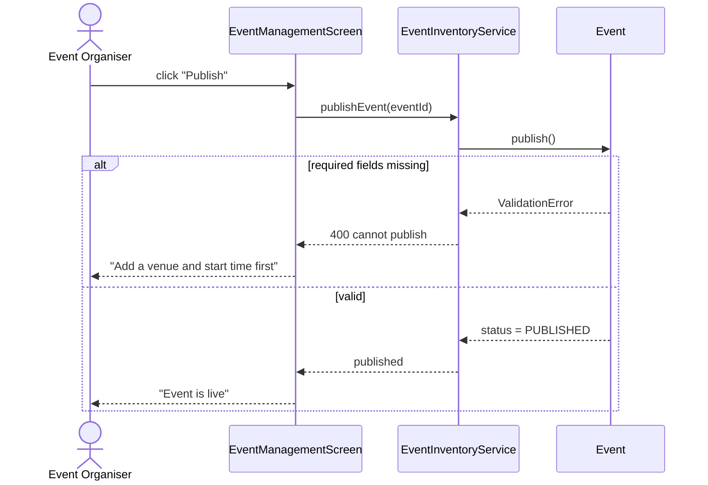

### OR-06 — Edit / Cancel Event

Two branches on one screen. Cancellation deliberately stops at Event.cancel() — buyer notification isn't modeled since notifications are out of scope for this MVP.

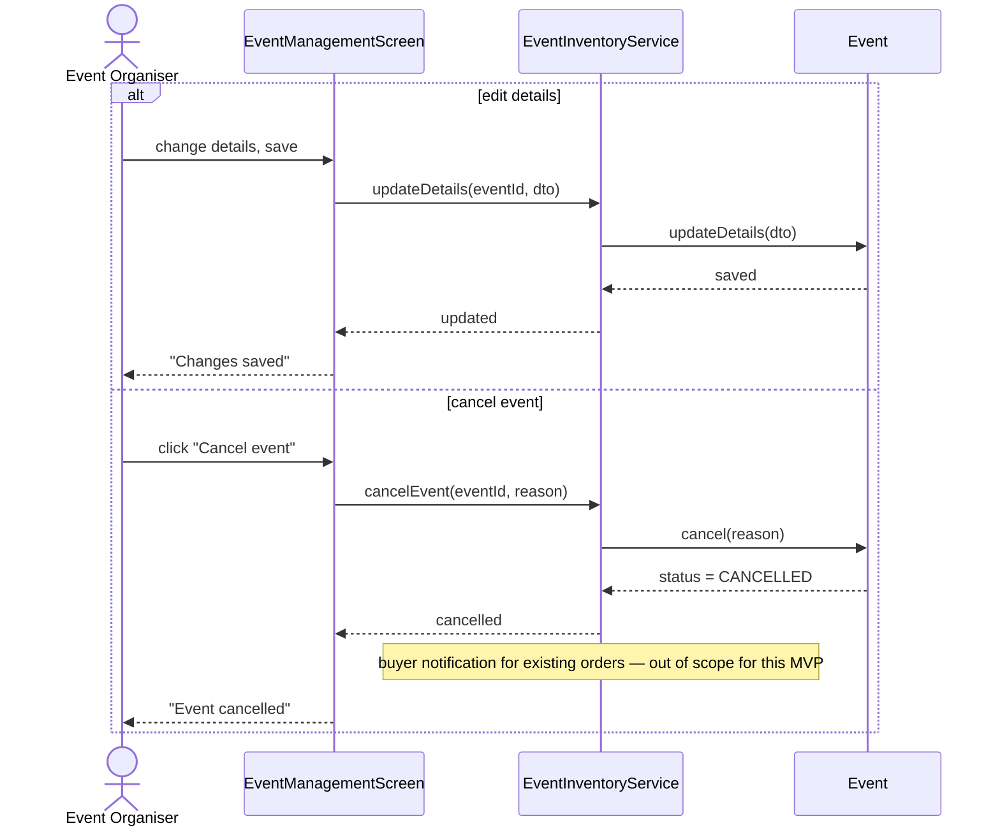

### OR-07 — Sales & Inventory Dashboard

Two services queried in parallel from one screen, matching the architecture decision that Checkout and Event & Inventory never share a database to join across.

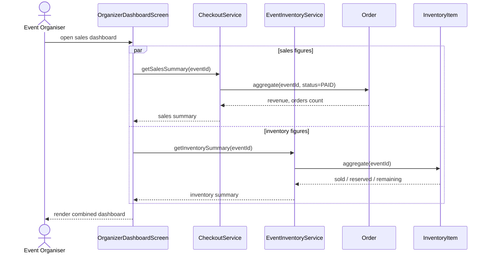

### OR-08 — Access Attendee & Order Data

Attendee ownership lives entirely in Checkout's schema — the organiser gets contact and order data without Event & Inventory or Ticketing being involved at all.

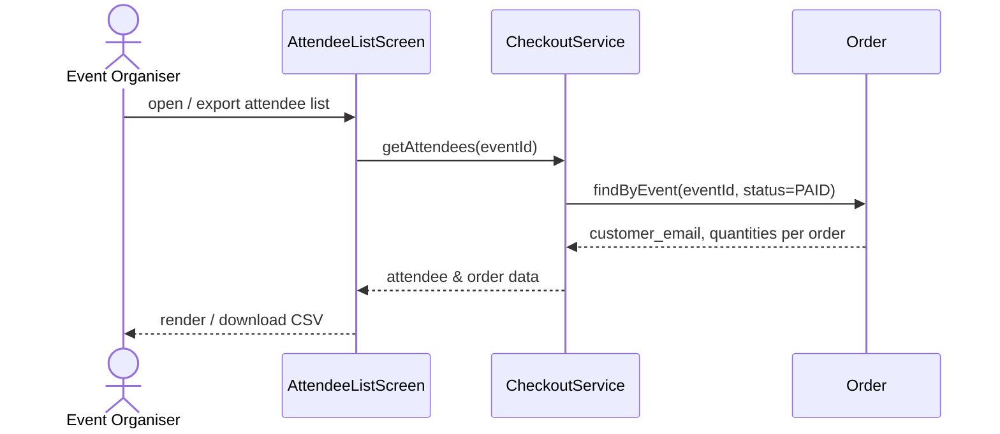

### OR-09 — View Check-In Progress

Reads straight from Ticketing's own check-in state — the same Ticket rows EH-02/EH-04 write to at the door, polled rather than pushed.

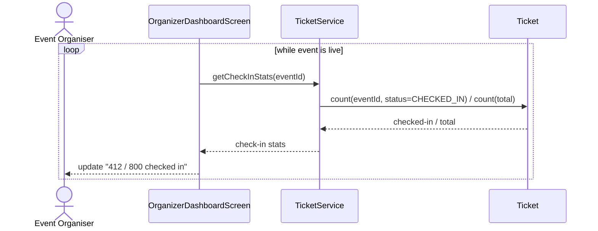

### OR-10 — Add Organiser / Helper to Event

The authorization check is drawn as an explicit step, and the reactivate-vs-create branch is exactly what the soft-revoke design decision exists to support.

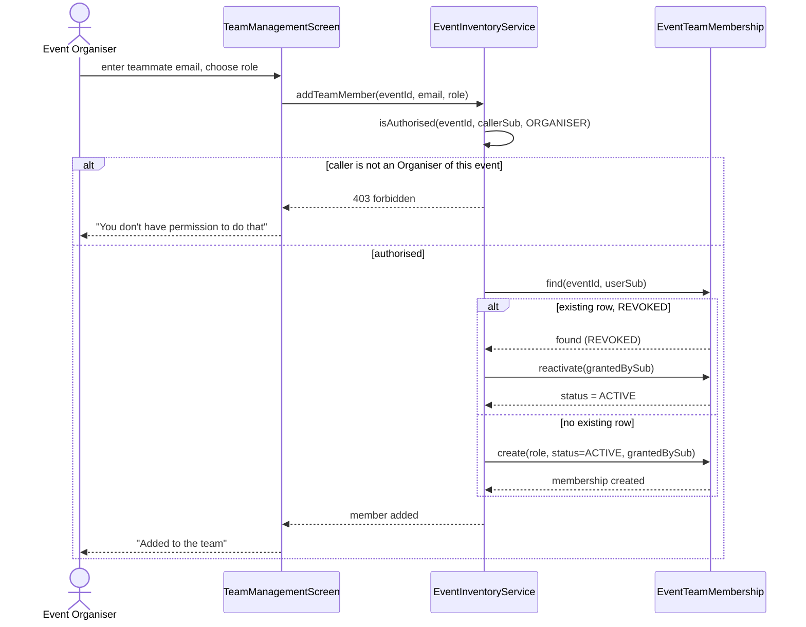

### OR-11 — View Event Team Roster

Filters to ACTIVE members only — a revoked membership stays in the table for audit but doesn't clutter the roster an organiser actually looks at.

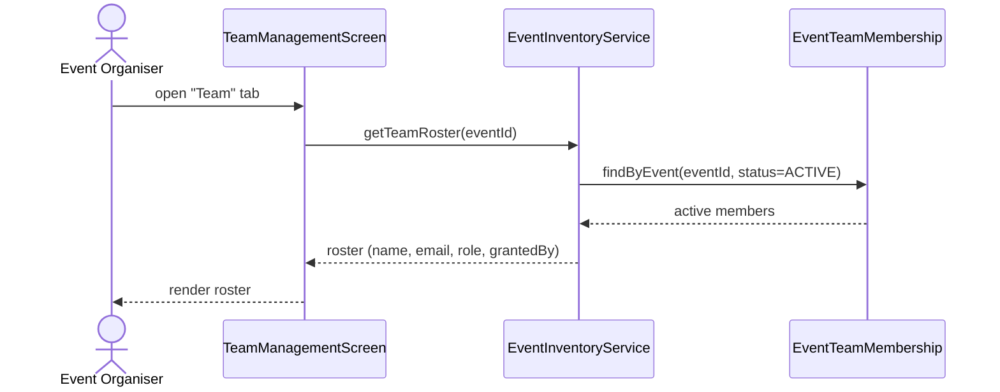

### OR-12 — Change Role / Remove Member

Revoking is guarded by a count of the event's remaining active Organisers before EventTeamMembership.revoke() is ever called — an event can't be orphaned.

```mermaid
sequenceDiagram
    actor Org as Event Organiser
    participant TMS as TeamManagementScreen
    participant EIS as EventInventoryService
    participant TM as EventTeamMembership

    alt change role
        Org->>TMS: change member's role
        TMS->>EIS: changeRole(eventId, userSub, newRole)
        EIS->>TM: update(role=newRole)
        TM-->>EIS: saved
        EIS-->>TMS: role changed
        TMS-->>Org: "Role updated"
    else revoke access
        Org->>TMS: remove member
        TMS->>EIS: revokeTeamMember(eventId, userSub)
        EIS->>TM: countActive(eventId, role=ORGANISER)
        alt member is the last active Organiser
            TM-->>EIS: activeOrganisers = 1
            EIS-->>TMS: 409 cannot remove last Organiser
            TMS-->>Org: "Add another Organiser before removing this one"
        else safe to revoke
            TM-->>EIS: activeOrganisers > 1
            EIS->>TM: revoke()
            TM-->>EIS: status = REVOKED, revokedAt set
            EIS-->>TMS: member revoked
            TMS-->>Org: "Removed from the team"
        end
    end
```

## Event Helper (6)

### EH-01 — Sign In to Scanner App

Same thin authentication handoff as OR-01, plus one extra step: the scanner won't unlock for an event unless EventTeamMembership actually says this user belongs to it.

```mermaid
sequenceDiagram
    actor Helper as Event Helper
    participant SLS as ScannerLoginScreen
    participant COG as Amazon Cognito
    participant EIS as EventInventoryService
    participant TM as EventTeamMembership

    Helper->>SLS: sign in, select event
    SLS->>COG: authenticate
    COG-->>SLS: JWT (sub)
    SLS->>EIS: isAuthorised(eventId, sub, HELPER_or_ORGANISER)
    EIS->>TM: find(eventId, sub, status=ACTIVE)
    alt no active membership
        TM-->>EIS: not found
        EIS-->>SLS: 403 forbidden
        SLS-->>Helper: "You're not on this event's team"
    else authorised
        TM-->>EIS: role = HELPER or ORGANISER
        EIS-->>SLS: authorised
        SLS-->>Helper: scanner unlocked for this event
    end
```

### EH-02 — Scan Ticket QR Code

The happy-path round trip a door scan takes — lookup, state check, log — kept under the 2-second acceptance criterion by staying to one Control call.

```mermaid
sequenceDiagram
    actor Helper as Event Helper
    participant SCS as ScanScreen
    participant TIV as TicketService
    participant TK as Ticket
    participant CL as CheckInLog

    Helper->>SCS: scan attendee's QR code
    SCS->>TIV: validateTicket(eventId, qrToken, scannedBySub)
    TIV->>TK: findByQrToken(qrToken)
    TK-->>TIV: ticket (or not found)
    TIV->>TK: checkIn(scannedBySub)
    TK-->>TIV: result
    TIV->>CL: create(result, scannedAt)
    CL-->>TIV: logged
    TIV-->>SCS: result (under 2s)
    SCS-->>Helper: show result on screen
```

### EH-03 — See a Valid / Invalid Check-In Result

Same call as EH-02, but this diagram's focus is the four-way branch — each outcome gets its own unambiguous visual and audible signal at the boundary.

```mermaid
sequenceDiagram
    actor Helper as Event Helper
    participant SCS as ScanScreen
    participant TIV as TicketService
    participant TK as Ticket

    SCS->>TIV: validateTicket(eventId, qrToken, scannedBySub)
    TIV->>TK: checkIn(scannedBySub)
    alt ticket belongs to a different event
        TK-->>TIV: WRONG_EVENT
        TIV-->>SCS: WRONG_EVENT
        SCS-->>Helper: red screen + tone — "Wrong event"
    else already checked in
        TK-->>TIV: DUPLICATE
        TIV-->>SCS: DUPLICATE
        SCS-->>Helper: amber screen + tone — "Already used"
    else unknown QR token
        TK-->>TIV: INVALID
        TIV-->>SCS: INVALID
        SCS-->>Helper: red screen + tone — "Not a valid ticket"
    else valid, unused
        TK-->>TIV: SUCCESS
        TIV-->>SCS: SUCCESS
        SCS-->>Helper: green screen + tone — "Welcome in"
    end
```

### EH-04 — Block Duplicate Check-In

The guarantee itself lives inside Ticket.checkIn(): it only flips ISSUED to CHECKED_IN, and it's the same method both the QR scan and the manual lookup call.

```mermaid
sequenceDiagram
    actor Helper as Event Helper
    participant SCS as ScanScreen
    participant TIV as TicketService
    participant TK as Ticket

    Helper->>SCS: scan a ticket already used at the door
    SCS->>TIV: validateTicket(eventId, qrToken, scannedBySub)
    TIV->>TK: checkIn(scannedBySub)
    TK->>TK: check status == ISSUED before flipping to CHECKED_IN
    alt status already CHECKED_IN
        TK-->>TIV: DUPLICATE (ticket state unchanged)
        TIV-->>SCS: DUPLICATE
        SCS-->>Helper: "Already checked in — entry denied"
    else status == ISSUED
        TK->>TK: status = CHECKED_IN, checkedInAt, checkedInBySub
        TK-->>TIV: SUCCESS
        TIV-->>SCS: SUCCESS
        SCS-->>Helper: "Entry granted"
    end
    Note over TK: single source of truth — the Buyer App's "my tickets" view reads the same status
```

### EH-05 — Manual Ticket Lookup

A search step followed by the same checkIn() call EH-02 uses — manual lookup is a different Boundary, not a different way of validating a ticket.

```mermaid
sequenceDiagram
    actor Helper as Event Helper
    participant MLS as ManualLookupScreen
    participant TIV as TicketService
    participant TK as Ticket

    Helper->>MLS: search by name / email / order ID
    MLS->>TIV: searchTickets(eventId, query)
    TIV->>TK: findByEvent(eventId, query)
    TK-->>TIV: matching ticket(s)
    TIV-->>MLS: results
    MLS-->>Helper: select match, confirm check-in
    Helper->>MLS: confirm
    MLS->>TIV: validateTicket(eventId, ticketId, scannedBySub)
    TIV->>TK: checkIn(scannedBySub)
    TK-->>TIV: SUCCESS / DUPLICATE
    TIV-->>MLS: result
    MLS-->>Helper: show result
```

### EH-06 — View Live Check-In Progress

The same read as OR-09, from a different Boundary — Helpers and Organisers look at the same Ticketing-owned numbers from two different screens.

```mermaid
sequenceDiagram
    actor Helper as Event Helper
    participant CSS as CheckInStatsScreen
    participant TIV as TicketService
    participant TK as Ticket

    loop every 30s
        CSS->>TIV: getCheckInStats(eventId)
        TIV->>TK: count(eventId, status=CHECKED_IN) / count(total ISSUED)
        TK-->>TIV: checked-in / total
        TIV-->>CSS: stats
        CSS-->>Helper: update running count
    end
```

---

Companion document to *OneStage — User Stories & Use-Case Diagrams* and *OneStage — System Design*. Every Control call here corresponds to a method on the matching Service façade class, and every Entity interaction corresponds to a field or state transition already defined in the System Design doc's ERDs and class diagrams — this document only sequences them.
