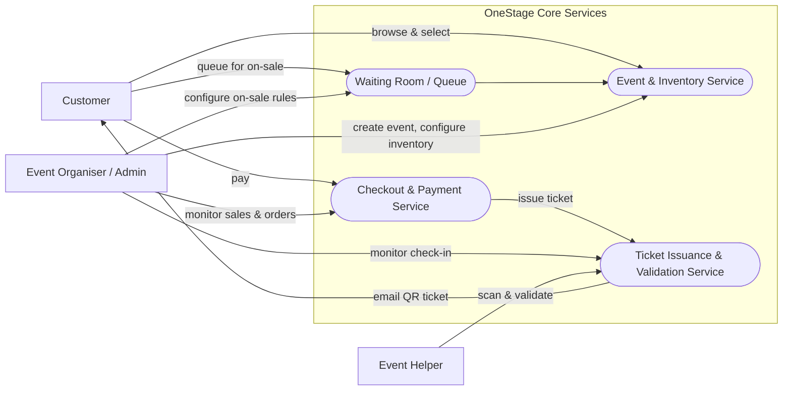
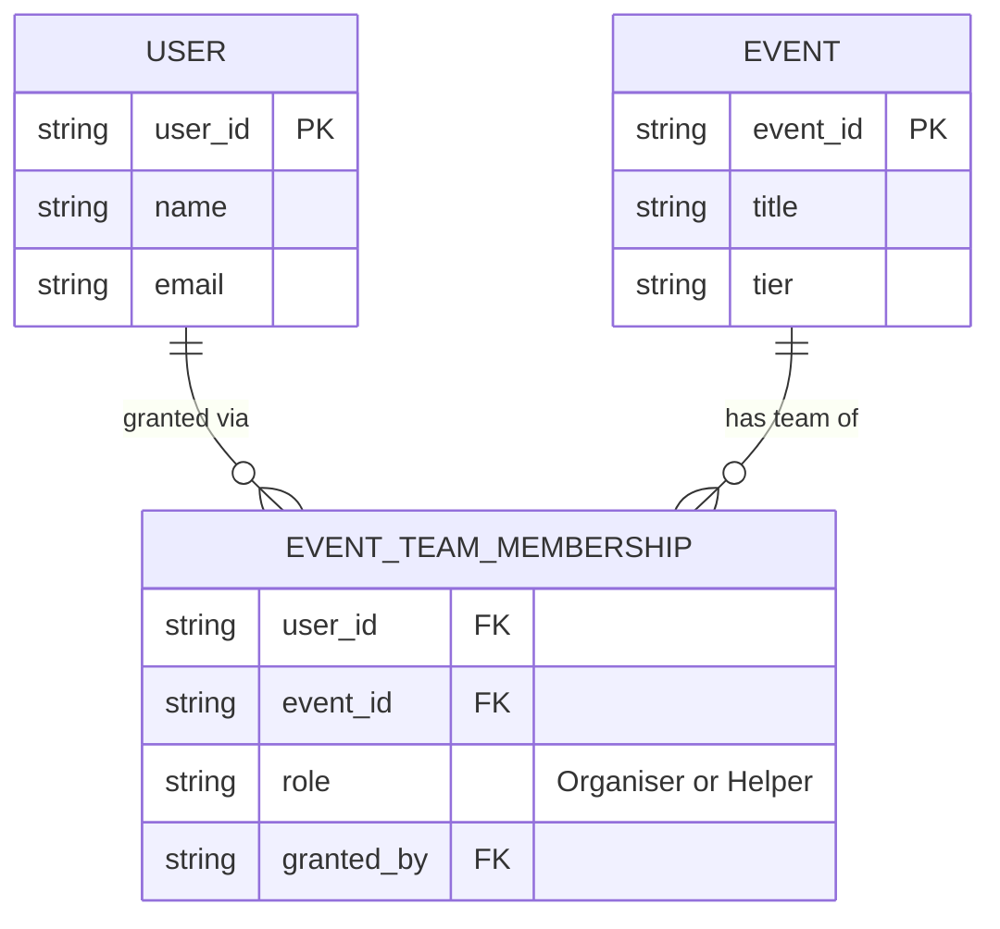
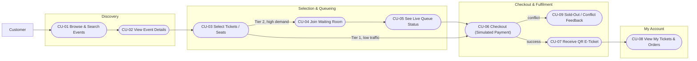
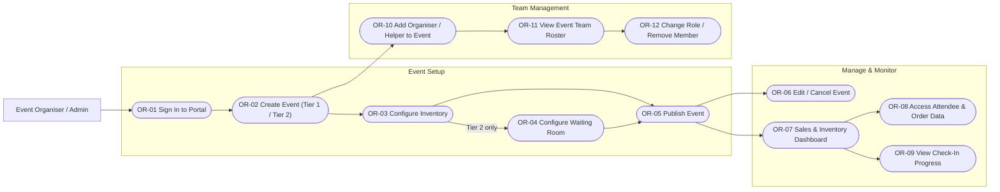
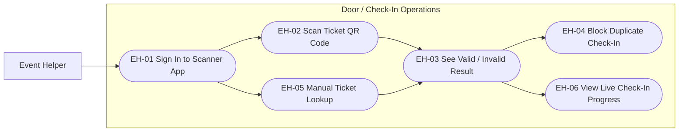

# OneStage — User Stories & Use-Case Diagrams

*SWE5001 — Architecting Scalable Systems, Graduate Certificate in Architecting Scalable Systems (NUS–ISS)*

OneStage is an elastic, cloud-native ticketing platform built around a single architectural thesis: the same core services — event creation, inventory management, checkout, and ticket validation — serve an eight-seat private dinner and an eight-thousand-seat concert equally well.

This document covers the three user roles: **Customer**, **Event Organiser / Admin**, and **Event Helper**. Each section has a Mermaid diagram mapping that role's stories, followed by the full story table (ID, story, acceptance criteria, MoSCoW priority).

Paste any of the fenced ```mermaid``` blocks below directly into the [Mermaid Live Editor](https://mermaid.live), a GitHub README, or a markdown-aware report tool to render them.

---

## System overview

Each role's stories land on one of OneStage's core services — the same reusable services the proposal names as the platform's core, exercised identically regardless of event size.



**Priority key:** `Must` = core to the MVP demo · `Should` = important, not launch-blocking · `Could` = nice to have if time permits.

---

## Roles & team membership

Events are normally run by a team, not one person. Organiser and Helper are **event-scoped roles**, not account types: a user can be an Organiser on one event, a Helper on another, and still buy tickets as a Customer everywhere — including their own event. Every account is a Customer by default; Organiser/Helper access exists only as a row in the join table below, and only an existing Organiser of that event can create one.



This is why the relationship is many-to-many both ways: one Organiser can run several events (and staff each with a different team), and one event can have several Organisers and Helpers at once. `granted_by` records which Organiser added the member, so access can be traced and a member can never grant themself a role.

---

## Customer

Discovers an event, gets a fair shot at limited inventory during a high-demand on-sale, and walks away with a QR ticket — whether they're buying 1 of 8 seats or 1 of 8,000.



| ID | User story | Acceptance criteria | Priority |
|---|---|---|---|
| CU-01 | As a customer, I want to browse and search events by name, date, location, and tier, so that I can find events I'm interested in. | Results show name, date, venue, tier badge, and price range; search returns matches in under 2s under normal load. | Must |
| CU-02 | As a customer, I want to view an event's full details, including live availability, so that I can decide whether to buy. | Detail page shows remaining GA quantity (Tier 1) or a live virtual seat map (Tier 2). | Must |
| CU-03 | As a customer, I want to choose a ticket quantity or select specific seats on a virtual seat map, so that I reserve exactly what I want. | Selection is soft-locked for a limited window; seats already taken show as unavailable in real time. | Must |
| CU-04 | As a customer, I want to be placed in a virtual waiting room for a high-demand on-sale, so that I get a fair, orderly shot at limited inventory. | I'm assigned a queue position on entry; refreshing or opening extra tabs cannot skip the queue. | Must |
| CU-05 | As a customer, I want to see my live position and estimated wait time in the queue, so that I know how long I'll be waiting. | Position and estimate refresh at least every 15 seconds without a manual reload. | Should |
| CU-06 | As a customer, I want to complete a simulated, tokenized checkout once I reach the front of the queue (or immediately for low-traffic events), so that I can finish my purchase securely and quickly. | No raw card data is stored; a clear message and a released hold are shown if my window expires before I pay. | Must |
| CU-07 | As a customer, I want an order confirmation and QR-coded e-ticket by email right after purchase, so that I have proof of purchase and a way to enter the venue. | Email arrives within 60s of successful payment with one unique QR code per ticket. | Must |
| CU-08 | As a customer, I want to view my past and upcoming orders and re-access my e-tickets in-app, so that I don't have to dig through my inbox. | Order history lists event, tier, seats/quantity, and a re-downloadable QR ticket. | Should |
| CU-09 | As a customer, I want to be told immediately if my selected seats become unavailable before I finish paying, so that I'm never charged for a ticket that doesn't exist. | A concurrency conflict returns an explicit "no longer available" state and releases my hold; no seat is ever confirmed to two buyers. | Must |

---

## Event Organiser / Admin

Sets up an event on either tier, configures the exact inventory the concurrency-safe locking engine must protect, staffs it with co-organisers and helpers, and keeps ownership of their own sales and attendee data.



| ID | User story | Acceptance criteria | Priority |
|---|---|---|---|
| OR-01 | As an event organiser, I want to securely log in to the organizer portal, so that only my team can manage my events and data. | Access is scoped to the organiser's own events; sessions expire after inactivity. | Must |
| OR-02 | As an event organiser, I want to create a new event and choose Tier 1 (general admission) or Tier 2 (fixed-inventory on-sale), so that the platform applies the right inventory and traffic-shaping model. | Tier choice determines whether a seat map and waiting room are configured later; core fields are required to save a draft. | Must |
| OR-03 | As an event organiser, I want to configure the exact ticket quantity (Tier 1) or seat map / fixed inventory (Tier 2, e.g. 8 to 8,000 seats), so that the platform enforces capacity and never oversells. | Saved inventory count is the single source of truth the locking engine checks against on every reservation. | Must |
| OR-04 | As an event organiser, I want to configure waiting-room and on-sale settings for a Tier 2 event, so that I control how demand is shaped at launch. | On-sale start time and queue admission rate are configurable per event before publishing. | Should |
| OR-05 | As an event organiser, I want to publish a finished event so it becomes visible and purchasable, so that I control exactly when sales open. | An unpublished event is never visible to customers; publishing is a single, reversible action. | Must |
| OR-06 | As an event organiser, I want to edit event details or cancel an event before or after publishing, so that I can correct mistakes or respond to real-world changes. | Cancelling a published event with existing orders triggers a notification to affected buyers. | Should |
| OR-07 | As an event organiser, I want a live dashboard of tickets sold, remaining inventory, revenue, and queue length, so that I can track my on-sale as it happens. | Dashboard figures update in near real time during an active on-sale. | Must |
| OR-08 | As an event organiser, I want to view and export my own attendee list and order data, so that I keep ownership of my customer relationships. | Export includes attendee contact info and order details tied to my own events only. | Must |
| OR-09 | As an event organiser, I want to see how many attendees have checked in versus tickets sold in real time on event day, so that I know attendance status without asking door staff. | Check-in count updates as the scanner app validates tickets. | Should |
| OR-10 | As an event organiser, I want to add another registered user as an Organiser or Helper on one of my events, so that my team can share the work of running it. | Adding by email grants that permission for this event only; only an existing Organiser of the event can add members; the member keeps buying tickets as a Customer, including to this event. | Must |
| OR-11 | As an event organiser, I want to see the roster of Organisers and Helpers on my event, so that I know who has access and in what role. | Roster lists each member's name, email, role, and who granted it, scoped to the one event. | Should |
| OR-12 | As an event organiser, I want to change a member's role between Organiser and Helper, or remove them from the event, so that I can adjust the team as responsibilities change. | Removal revokes portal/scanner access immediately; the system blocks removing the last remaining Organiser so the event can never be left without one. | Should |

---

## Event Helper

Runs the door with the scanner app, reusing the same ticket-validation API the buyer app relies on internally — one source of truth so a ticket can never be used twice.



| ID | User story | Acceptance criteria | Priority |
|---|---|---|---|
| EH-01 | As an event helper, I want to log into the scanner app scoped to the specific event I'm working, so that I can only validate tickets for that event. | Login restricts scanning to one event; no cross-event ticket lookups are possible. | Must |
| EH-02 | As an event helper, I want to scan an attendee's QR-coded ticket at the door, so that I can quickly confirm it's valid for entry. | Scan-to-result feedback appears in under 2 seconds on a normal venue network. | Must |
| EH-03 | As an event helper, I want an unambiguous valid / already-used / invalid / wrong-event result, so that I can make a fast, confident entry decision. | Each outcome has a distinct visual (and audible) signal — no raw data to interpret. | Must |
| EH-04 | As an event helper, I want the system to reject a ticket that's already been checked in, so that no ticket can admit more than one person. | Validation calls the same ticket-validation API used elsewhere in the platform, so ticket state has one source of truth. | Must |
| EH-05 | As an event helper, I want to manually search a ticket by name, email, or order ID when a QR code won't scan, so that I can still check the guest in. | Search returns a match in under 5 seconds and lets me complete check-in from the result. | Should |
| EH-06 | As an event helper, I want to see a running count of check-ins versus tickets sold, so that I can gauge how busy entry still is. | Count reflects check-ins from all door stations in near real time. | Could |

---

*Scope reflects the proposal's Tier 1 (general admission) and Tier 2 (fixed-inventory, high-demand on-sale) event types. Out of scope for this MVP: dynamic pricing, resale/secondary markets, a real payment processor, and production-grade anti-bot systems — the pipeline demonstrates the rate-limiting/queueing mitigation pattern instead.*
