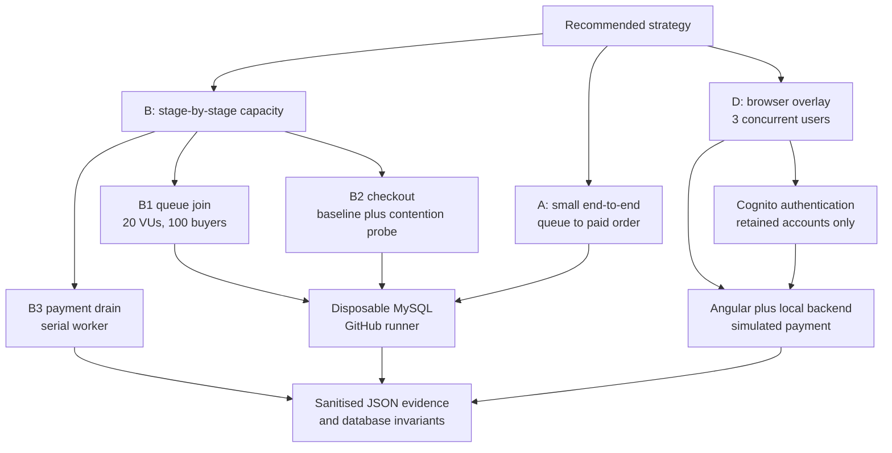

# OneStage buyer-workflow capacity evidence

- **Course:** SWE5001 — Architecting Scalable Systems
- **Date:** 13 October 2026
- **Backend evidence:** [GitHub Actions run 38338873107](https://github.com/nus-mtech-grp1-sem2/backend-repo/actions/runs/38338873107), commit `1a205fc`
- **Browser evidence:** [GitHub Actions run 38339428584](https://github.com/nus-mtech-grp1-sem2/core-frontend/actions/runs/38339428584), commit `bc31fac`
- **Outcome:** all B, A and D evidence jobs passed

## Purpose and interpretation boundary

This report records the implemented form of the recommended buyer-workflow strategy: stage-by-stage capacity evidence (B), a smaller end-to-end run (A), and a few real browser users (D). The objective is repeatable evidence for the school project, not a production-readiness certification.

All state-changing API tests used disposable MySQL databases on GitHub-hosted runners. The Playwright run used a disposable local Docker Compose backend, simulated payment and three retained Cognito accounts. No test changed Cognito users, called the live backend, sent real payments or notifications, or retained application data.

## Results summary

| Strategy | Scenario | Load shape | Result | Principal evidence |
|---|---|---|---|---|
| B1 | Queue join | 100 iterations shared by 20 VUs | Pass | 100/100 joins; p95 103.83 ms; 100 unique buyers persisted |
| B2 | Checkout baseline | 50 iterations with 1 VU | Pass | 50/50 orders created and paid; 100% checks passed |
| B2 | Checkout contention probe | 30 iterations shared by 3 VUs | Observational pass | 26 paid; 4 classified contention failures; 0 unexpected responses |
| B3 | Serial payment drain | 40 messages; worker concurrency 1; 25 ms simulated processing delay | Pass | 1,022 ms total; 39.14 messages/s |
| Additional | No-oversell race | 50 buyers shared by 20 VUs competing for 10 tickets | Pass | 10 holds; 40 safe rejections; 0 unexpected responses or server errors |
| A | Queue-to-paid buyer journey | 10 iterations with 1 VU | Pass | 10/10 completed; request p95 18.63 ms; journey p95 73.77 ms |
| D | Browser buyer overlay | 3 concurrent Chromium contexts | Pass | 3/3 completed; total journey 10.67–11.04 s |

## B — stage-by-stage capacity evidence

### B1 queue join

The queue test started 100 distinct buyers across 20 k6 VUs. Every join returned the expected result and the database verifier found 100 unique buyers. The stored queue positions contained 13 observed position values, reflecting concurrent allocation rather than duplicate buyer records.

| Metric | Result |
|---|---:|
| Successful joins | 100 / 100 |
| Checks | 100 passed, 0 failed |
| Request rate | 299.47 requests/s |
| Request duration average | 62.05 ms |
| Request duration p95 | 103.83 ms |
| Request duration maximum | 145.36 ms |

This is an isolated handler-and-database result. It does not include Kong, network latency or the deployed single-database task.

### B2 checkout baseline and contention probe

The deterministic baseline proved the normal checkout path before the separate contention probe was interpreted. All 50 baseline orders were created and paid. The 3-VU probe then recorded 26 paid orders and four classified contention failures. No response fell outside the expected paid-or-contention classifications. Database reconciliation confirmed that all 76 successfully created orders were paid exactly once.

| Metric | Result |
|---|---:|
| Baseline paid orders | 50 / 50 |
| Contention attempts | 30 |
| Contention paid orders | 26 |
| Classified contention failures | 4 |
| Unexpected responses | 0 |
| Request duration average | 16.37 ms |
| Request duration p95 | 42.66 ms |
| Request duration maximum | 576.63 ms |
| Reconciled paid orders | 76 / 76, one payment each |

The four contention failures are capacity evidence, not a hidden pass. They show that the deterministic sequential path is correct while a small concurrent checkout burst can encounter the current locking or service-contention boundary.

### B3 serial payment drain

The payment-drain harness measured the deliberately serial worker with a controlled 25 ms processing delay.

| Metric | Result |
|---|---:|
| Messages processed | 40 |
| Worker concurrency | 1 |
| Simulated processing delay | 25 ms/message |
| Total duration | 1,022 ms |
| Measured throughput | 39.14 messages/s |

This is a deterministic implementation-level measurement. It does not include the production SQS delivery delay, external payment latency, ECS resource contention or ticket and notification consumers, so 39.14 messages/s must not be presented as deployed payment capacity.

### Additional no-oversell race

Fifty buyers concurrently attempted one-ticket holds against ten available tickets. Exactly ten holds succeeded and forty attempts received safe capacity/contention rejection. Database reconciliation confirmed ten active holds and no oversell.

| Metric | Result |
|---|---:|
| Concurrent buyers | 50 iterations across 20 VUs |
| Successful holds | 10 |
| Safe rejections | 40 |
| Unexpected responses | 0 |
| Unexpected server errors | 0 |
| Request duration p95 | 303.62 ms |
| Database invariant | Passed; no oversell |

## A — smaller end-to-end journey

The A scenario exercised queue join, admission, queue status, order creation and simulated payment against the disposable queue and order services. Ten sequential buyers completed the journey and the database verifier found ten paid orders with one payment each.

| Metric | Result |
|---|---:|
| Completed journeys | 10 / 10 |
| HTTP requests | 50 |
| Checks | 10 passed, 0 failed |
| Request duration average | 6.86 ms |
| Request duration p95 | 18.63 ms |
| Journey duration average | 34.93 ms |
| Journey duration p95 | 73.77 ms |
| Journey duration maximum | 101.65 ms |

This run proves functional composition and records a repeatable local baseline. One VU and ten iterations do not establish a deployed breaking point.

## D — three-user browser overlay

Three Chromium browser contexts signed in with existing Cognito accounts and used the Angular UI concurrently. Each buyer browsed the event, selected one ticket, completed checkout with the simulated card and observed the paid event in My Events. Playwright traces were disabled so tokens were not retained.

| User role | Browse to checkout | Checkout to paid | Total journey |
|---|---:|---:|---:|
| Customer | 2,993 ms | 7,755 ms | 10,748 ms |
| Customer 2 | 3,544 ms | 7,499 ms | 11,043 ms |
| Helper | 3,044 ms | 7,625 ms | 10,669 ms |

| Aggregate metric | Result |
|---|---:|
| Browser users | 3 |
| Successful journeys | 3 / 3 |
| Minimum total | 10,669 ms |
| Median total | 10,748 ms |
| Maximum total | 11,043 ms |

The approximately 7.5-second checkout-to-paid interval dominates the browser journey and is consistent with the intentionally delayed asynchronous payment path. These are local end-user timings, not Internet or CloudFront latency. D validates the buyer experience under a small overlay; it is not a load generator or capacity curve.

The same workflow also completed 52 prerequisite full-stack tests before running the browser overlay. The browser project reported five passed Playwright tests, including authentication setup and the three-user journey.

## Evidence and reproducibility

| Evidence | Location | Retention |
|---|---|---|
| B and A workflow | [backend run 38338873107](https://github.com/nus-mtech-grp1-sem2/backend-repo/actions/runs/38338873107) | Workflow history retained by GitHub |
| B and A JSON artifacts | Five `k6-*` artifacts on the backend run | Until 27 October 2026 |
| D workflow | [frontend run 38339428584](https://github.com/nus-mtech-grp1-sem2/core-frontend/actions/runs/38339428584) | Workflow history retained by GitHub |
| D timing artifact | [`playwright-buyer-load-38339428584`](https://github.com/nus-mtech-grp1-sem2/core-frontend/actions/runs/38339428584/artifacts/11785744605) | Until 27 October 2026 |

The durable figures are reproduced in this document because GitHub Actions artifacts expire. Credential values, access tokens, response bodies and browser traces are not included.

## Conclusions

The evidence demonstrates three different properties rather than one production-capacity claim:

- **B identifies stage behaviour:** queue joins remained correct at the tested 20-VU burst; checkout remained deterministic sequentially and exposed four classified failures under a small contention probe; the serial payment worker processed the controlled harness at 39.14 messages/s.
- **A proves the service composition:** ten buyers completed queue-to-payment with reconciled database state.
- **D proves the UI path:** three concurrent authenticated browsers completed the buyer journey in 10.67–11.04 seconds.
- **Correctness under oversubscription was preserved:** ten tickets produced exactly ten holds and forty safe rejections.

The tests do not establish live AWS saturation, ECS autoscaling behaviour, Kong limits, CloudFront latency or a production maximum. Those claims would require an explicitly authorised deployed-stack test with monitoring and an isolated data strategy.
