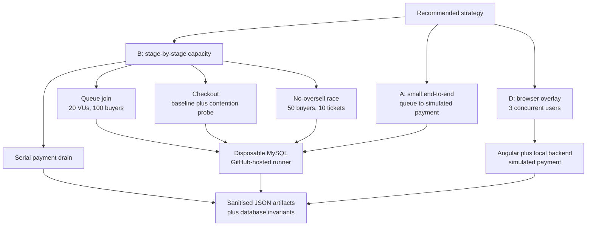

# OneStage buyer-workflow capacity evidence

- **Course:** SWE5001 — Architecting Scalable Systems
- **Date:** 17 October 2026
- **Backend evidence:** [GitHub Actions run 39023558156](https://github.com/nus-mtech-grp1-sem2/backend-repo/actions/runs/39023558156), commit `de226c8`
- **Browser evidence:** [GitHub Actions run 39023560283](https://github.com/nus-mtech-grp1-sem2/core-frontend/actions/runs/39023560283), commit `0de5d5c`
- **Outcome:** all A, B and D evidence jobs passed

## Purpose and safety boundary

This report records a fresh execution of the recommended buyer-workflow strategy: stage-by-stage capacity tests (B), a smaller end-to-end run (A), and a few real browser users (D). The objective is repeatable evidence for the school project, not production-readiness certification.

The state-changing k6 scenarios ran against disposable MySQL databases on GitHub-hosted runners. The Playwright workflow used a disposable local Docker Compose backend, simulated payment and three retained Cognito accounts. The run did not target the live backend, modify Cognito users, perform real payments or subscriptions, send real notifications, or retain application data.

## Results summary

| Strategy | Scenario | Load shape | Outcome | Principal evidence |
|---|---|---|---|---|
| B1 | Queue join | 100 iterations shared by 20 VUs | Pass | 100/100 joins; p95 119.24 ms; 100 unique buyers persisted |
| B2 | Checkout baseline | 50 iterations with 1 VU | Pass | 50/50 orders created and paid; 100% checks passed |
| B2 | Checkout contention probe | 30 iterations shared by 3 VUs | Observational pass | 16 paid; 14 classified contention failures; 0 unexpected responses |
| B3 | Serial payment drain | 40 messages; worker concurrency 1; 25 ms simulated delay | Pass | 1,023 ms total; 39.10 messages/s |
| Additional B | No-oversell race | 50 buyers shared by 20 VUs competing for 10 tickets | Pass | 10 holds; 40 safe rejections; no unexpected responses, server errors or oversell |
| A | Queue-to-paid buyer journey | 10 iterations with 1 VU | Pass | 10/10 completed; request p95 12.63 ms; journey p95 66.86 ms |
| D | Browser buyer overlay | 3 concurrent Chromium contexts | Pass | 3/3 completed; total journey 13.27–13.45 s |

## B — stage-by-stage capacity evidence

### B1 queue join

The queue test started 100 distinct buyers across 20 k6 VUs. Every join passed its check. The database verifier found 100 unique buyers and 13 observed stored position values, confirming unique records while reflecting concurrent position allocation.

| Metric | Result |
|---|---:|
| Successful joins | 100 / 100 |
| Checks | 100 passed, 0 failed |
| Request rate | 274.51 requests/s |
| Request duration average | 67.58 ms |
| Request duration p95 | 119.24 ms |
| Request duration maximum | 132.06 ms |
| Database invariant | 100 unique buyers |

This is isolated service-and-database evidence. It does not include Kong, Internet latency or deployed AWS resource contention.

### B2 checkout baseline and contention probe

The deterministic single-VU baseline completed 50 paid orders before the separate three-VU contention probe ran. The probe produced 16 paid orders and 14 classified contention failures, with no unexpected responses. Database reconciliation confirmed that all 66 successfully created orders were paid exactly once.

| Metric | Result |
|---|---:|
| Baseline paid orders | 50 / 50 |
| Contention attempts | 30 |
| Contention paid orders | 16 |
| Classified contention failures | 14 |
| Unexpected responses | 0 |
| Request duration average | 19.28 ms |
| Request duration p95 | 60.77 ms |
| Request duration maximum | 302.14 ms |
| Database invariant | 66 / 66 orders paid, one payment each |

The contention scenario is an observational pass because every response was classified and the database remained correct. It is not a claim that all concurrent checkout attempts succeeded: 46.7% of the probe attempts encountered the current contention boundary.

### B3 serial payment drain

The deterministic harness measured the deliberately serial worker with a controlled 25 ms processing delay.

| Metric | Result |
|---|---:|
| Messages processed | 40 |
| Worker concurrency | 1 |
| Simulated processing delay | 25 ms/message |
| Total duration | 1,023 ms |
| Measured throughput | 39.10 messages/s |

This does not include SQS delivery, external payment latency, ECS contention, or downstream ticket and notification consumers. It must not be presented as deployed payment capacity.

### Additional no-oversell race

Fifty buyers concurrently attempted one-ticket holds against ten available tickets. Exactly ten holds succeeded and forty attempts received safe rejections. All 50 checks passed, no response was unexpected, no server error occurred, and database reconciliation confirmed no oversell.

| Metric | Result |
|---|---:|
| Buyers | 50 iterations across 20 VUs |
| Successful holds | 10 |
| Safe rejections | 40 |
| Unexpected responses | 0 |
| Unexpected server errors | 0 |
| Request duration p95 | 105.86 ms |
| Database invariant | 10 holds; no oversell |

## A — smaller end-to-end journey

The A scenario exercised queue join, admission, queue status, order creation and simulated payment against disposable queue and order services. Ten sequential buyers completed the journey. The database verifier found ten paid orders with exactly one payment each.

| Metric | Result |
|---|---:|
| Completed journeys | 10 / 10 |
| HTTP requests | 50 |
| Checks | 10 passed, 0 failed |
| Request duration average | 6.56 ms |
| Request duration p95 | 12.63 ms |
| Journey duration average | 33.74 ms |
| Journey duration p95 | 66.86 ms |
| Journey duration maximum | 94.40 ms |
| Database invariant | 10 / 10 orders paid, one payment each |

This proves functional composition and supplies a repeatable disposable-environment baseline. One VU and ten iterations do not establish a deployed breaking point.

## D — three-user browser overlay

Three Chromium contexts signed in using retained Cognito accounts and exercised the Angular UI concurrently against a disposable local backend. Each buyer browsed the event, selected one ticket, completed checkout using simulated payment and observed the paid event in My Events. Browser traces were disabled to avoid retaining tokens.

| User role | Browse to checkout | Checkout to paid | Total journey |
|---|---:|---:|---:|
| Customer | 5,667 ms | 7,782 ms | 13,449 ms |
| Customer 2 | 5,576 ms | 7,733 ms | 13,310 ms |
| Helper | 5,587 ms | 7,679 ms | 13,266 ms |

| Aggregate metric | Result |
|---|---:|
| Browser users | 3 |
| Successful journeys | 3 / 3 |
| Minimum total | 13,266 ms |
| Median total | 13,310 ms |
| Maximum total | 13,449 ms |

The workflow first completed 52 full-stack regression tests in 7.5 minutes. The dedicated browser-load project then completed five Playwright tests in 47.2 seconds, including authentication setup and the three-user buyer journey.

The roughly 7.7-second checkout-to-paid interval remains the dominant browser stage and is consistent with the deliberately delayed asynchronous payment path. D validates the workflow with a small concurrent overlay; it is not a browser-generated capacity test.

## Comparison with the 13 October run

This comparison helps identify repeatability, but it is not a controlled benchmark because GitHub-hosted runner performance varies.

| Scenario | 13 October | 17 October | Interpretation |
|---|---:|---:|---|
| Queue request p95 | 103.83 ms | 119.24 ms | Higher, but still well below the 1,500 ms threshold with 100/100 successful joins |
| Checkout probe paid / contention | 26 / 4 | 16 / 14 | The contention boundary is variable and reproducible; correctness invariants still passed |
| A journey p95 | 73.77 ms | 66.86 ms | Similar disposable-environment baseline |
| D total journey range | 10.67–11.04 s | 13.27–13.45 s | Browse-to-checkout was slower; checkout-to-paid remained near the simulated-delay baseline |

## Evidence and retention

| Evidence | Location | Expires |
|---|---|---|
| A and B workflow | [Backend run 39023558156](https://github.com/nus-mtech-grp1-sem2/backend-repo/actions/runs/39023558156) | Workflow history retained by GitHub |
| Queue JSON | [Artifact 12097243037](https://github.com/nus-mtech-grp1-sem2/backend-repo/actions/runs/39023558156/artifacts/12097243037) | 31 October 2026 |
| Checkout JSON | [Artifact 12097786559](https://github.com/nus-mtech-grp1-sem2/backend-repo/actions/runs/39023558156/artifacts/12097786559) | 31 October 2026 |
| A journey JSON | [Artifact 12097518400](https://github.com/nus-mtech-grp1-sem2/backend-repo/actions/runs/39023558156/artifacts/12097518400) | 31 October 2026 |
| Payment-drain JSON | [Artifact 12097528102](https://github.com/nus-mtech-grp1-sem2/backend-repo/actions/runs/39023558156/artifacts/12097528102) | 31 October 2026 |
| No-oversell JSON | [Artifact 12096953691](https://github.com/nus-mtech-grp1-sem2/backend-repo/actions/runs/39023558156/artifacts/12096953691) | 31 October 2026 |
| D workflow | [Frontend run 39023560283](https://github.com/nus-mtech-grp1-sem2/core-frontend/actions/runs/39023560283) | Workflow history retained by GitHub |
| D timing JSON | [Artifact 12096964222](https://github.com/nus-mtech-grp1-sem2/core-frontend/actions/runs/39023560283/artifacts/12096964222) | 31 October 2026 |

The durable figures are reproduced here because workflow artifacts expire. No credential values, access tokens, response bodies or browser traces are included.

## Conclusions and limitations

- B preserved correctness at every tested stage. Queue joining completed successfully, the checkout baseline passed, and oversubscription produced exactly ten holds for ten tickets.
- The checkout contention probe exposed a material concurrency boundary: 14 of 30 attempts were safely classified as contention failures. This is useful scalability evidence, not a production-capacity pass.
- A completed ten queue-to-payment journeys with reconciled database state.
- D completed all three authenticated browser journeys after the 52-test full-stack regression suite passed.
- The tests did not establish live AWS saturation, ECS autoscaling behavior, Kong limits, CloudFront latency, long-duration soak behavior or a production maximum.

GitHub emitted non-blocking runner notices that pinned JavaScript actions still target the deprecated Node.js 20 action runtime and are currently forced onto Node.js 24. This did not affect the test conclusions, but the action versions should be reviewed separately before GitHub removes compatibility behavior.
