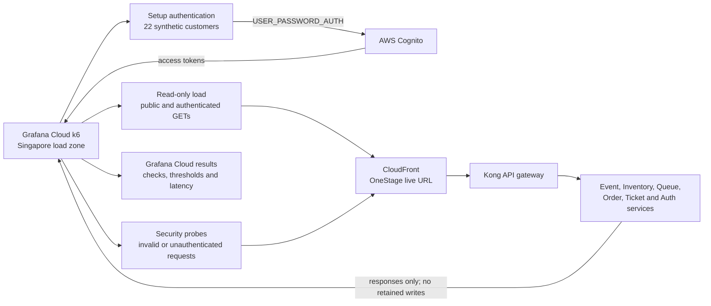

# OneStage Grafana Cloud k6 Test Results

- **Course:** SWE5001 — Architecting Scalable Systems
- **Test:** [OneStage read-only manual](https://onestage.grafana.net/a/k6-app/tests/1381407)
- **Detailed run:** [Grafana Cloud run 8781785](https://onestage.grafana.net/a/k6-app/runs/8781785)
- **Run displayed by Grafana:** 10 October 2026, 18:19 (timezone not shown)
- **Load zone:** Singapore
- **k6 version:** v2.3

## Purpose and safety boundary

This test provides repeatable performance evidence for the OneStage school project. It measures public and authenticated read paths, authentication, queue and booking guards, and service health through the deployed entry point. It is deliberately non-destructive: it does not create successful queue joins, inventory holds, orders, payments, tickets, check-ins, events, or notifications.

The test uses retained synthetic users for Cognito authentication. No credential or token values are recorded in this document.

## Test flow

## Latest run summary

| Metric | Result |
|---|---:|
| Status | Failed by threshold |
| Duration | 8 min 30 sec |
| Maximum virtual users | 55 VUs |
| Consumption | 7.8 VUh |
| Requests | 50,653 |
| Average request rate | 98 requests/sec |
| Peak request rate | 179.25 requests/sec |
| Overall p95 response time | 48 ms |
| HTTP failures | 2 |
| Checks | 101.3K / 101.3K passed |
| Thresholds | 11 / 14 passed |

The run sustained approximately 98 requests per second while keeping the overall p95 response time at 48 ms. Only two of 50,653 HTTP requests failed (approximately 0.004%), and every functional check passed. The run is nevertheless correctly recorded as **failed by threshold** because three strict custom thresholds failed.

## Scenario results

| Scenario | Requests | Failed requests | p95 response time | Average RPS | Purpose |
|---|---:|---:|---:|---:|---|
| `default` | 23 | 0 | 310 ms | 0.04 | Setup and Cognito authentication |
| `read_only` | 47.6K | 0 | 50 ms | 91.7 | Health, public event, booking-zone and authenticated read traffic |
| `security_probe` | 3.1K | 2 | 13 ms | 5.9 | Invalid queue lookup and unauthenticated write rejection |

Grafana rounds scenario counts and rates in this table; the overall request total above is the precise value shown in the performance overview.

## Threshold evidence

| Threshold | Target | Displayed result | Outcome |
|---|---:|---:|---|
| Overall request duration p95 | `< 2,000 ms` | 48 ms | Pass |
| Health endpoint duration p95 | `< 1,000 ms` | 44 ms | Pass |
| Public endpoint duration p95 | `< 1,500 ms` | 60 ms | Pass |
| Authenticated endpoint duration p95 | `< 2,000 ms` | 53 ms | Pass |
| Cognito authentication duration p95 | `< 2,000 ms` | 310 ms | Pass |
| HTTP failure rate | `< 1%` and `< 10%` | Displayed as 0 | Pass |
| `security_success` | `rate == 1` | Displayed as 1 | **Fail** |
| `unexpected_server_error` | `rate == 0` | Displayed as 0 | **Fail** |
| `unauthorized_write_rejected` | `rate == 1` | Displayed as 1 | **Fail** |

The three failed metrics use exact equality. Grafana displays their calculated values only at rounded precision, while the two failed HTTP requests make the underlying values differ slightly from the required exact boundary. Therefore the threshold status is more authoritative than the rounded value displayed in the table.

## Queue and booking coverage

The live-cloud run exercises queue and booking behavior without retaining application data:

- Reads booking-zone availability through the inventory API.
- Reads seat inventory when a published seated-event fixture is available.
- Confirms an authenticated queue-position request with an invalid event is rejected with `400`.
- Confirms an anonymous queue-join attempt is rejected before the mutation path with `401` or Kong throttling with `429`.
- Confirms anonymous inventory-hold, order-creation and payment attempts are rejected with `401` or `429` before their mutation paths.
- Confirms an authenticated order-detail request with an invalid identifier is rejected with `400`.
- Excludes successful queue joins, holds, checkout, payment and ticket issuance because those operations create or change application data.

A separate disposable CI test is implemented for stateful booking concurrency. It runs the real inventory service against an ephemeral MySQL instance, issues 50 concurrent one-ticket hold attempts against a ten-ticket fixture, requires exactly ten successful holds and forty safe conflicts, checks the inventory invariant, and discards the database afterward. No execution result from that CI test is included in this Grafana Cloud report.

## Run history

| Grafana run | Displayed time | Load zone | Status | VUs | Duration | p95 response time |
|---|---|---|---|---:|---:|---:|
| [8781785](https://onestage.grafana.net/a/k6-app/runs/8781785) | 10 Oct, 18:19 | Singapore | Failed by threshold | 55 | 8 min 30 sec | 47.6 ms |
| [8780327](https://onestage.grafana.net/a/k6-app/runs/8780327) | 10 Oct, 11:17 | Singapore | Failed by threshold | 50 | 12 min 54 sec | 35.1 ms |
| [8780287](https://onestage.grafana.net/a/k6-app/runs/8780287) | 10 Oct, 11:02 | Columbus | Failed by threshold | 50 | 5 min 15 sec | 394 ms |

## Interpretation and follow-up

The latest Singapore run demonstrates low latency and stable read throughput at the tested load. It also shows that the queue and booking safety guards were exercised, but the result must not be presented as a full production-readiness certification: successful state-changing customer journeys, recovery behavior, long-duration soak testing and infrastructure saturation were intentionally outside this run.

The immediate follow-up is to inspect the two failed security-probe responses and report the custom metric values at greater precision. Thresholds should remain meaningful rather than being relaxed solely to turn the run green. After correcting either the observed response handling or the metric calculation, rerun the same Singapore configuration and retain the passing run as comparison evidence.
