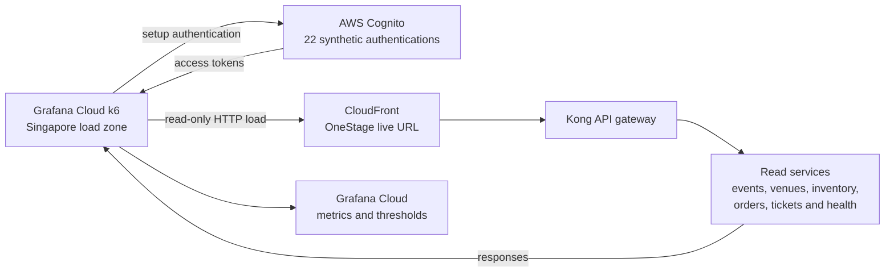

# OneStage Grafana Cloud k6 Stress-Test Results

- **Course:** SWE5001 — Architecting Scalable Systems
- **Test:** [OneStage read-only stress 2026-10-17](https://onestage.grafana.net/a/k6-app/tests/1393994)
- **Detailed run:** [Grafana Cloud run 8829235](https://onestage.grafana.net/a/k6-app/runs/8829235?tab=thresholds)
- **Run date:** 17 October 2026
- **Target:** `https://d3vlw6jnm44c4l.cloudfront.net`
- **Load zone:** Singapore
- **k6 version:** v2.3

## Objective and scope

This run provides academic stress-test evidence for OneStage by increasing read traffic to 100 concurrent virtual users against the deployed application. It evaluates latency, request failures, authentication, and functional checks under the configured load. It is a capped stress run, not a production-capacity certification or a breaking-point test.

The successful application operations were read-only `GET` requests. Setup authenticated 22 retained synthetic users through AWS Cognito. The test did not successfully join queues, create inventory holds or orders, initiate payments, issue or check in tickets, create events, send notifications, change subscriptions, or add, edit, or delete users.

## Test path

## Load profile

| Stage | Target VUs | Duration |
|---:|---:|---:|
| 1 | 10 | 1 min |
| 2 | 25 | 2 min |
| 3 | 50 | 2 min |
| 4 | 75 | 2 min |
| 5 | 100 | 2 min |
| 6 | 0 | 1 min |

Grafana reported an actual run duration of 9 min 30 sec and a maximum of 100 VUs.

## Results

| Metric | Result |
|---|---:|
| Status | Finished; all thresholds passed |
| Duration | 9 min 30 sec |
| Maximum virtual users | 100 VUs |
| Consumption | 15.84 VUh |
| Requests | 94,210 |
| Average request rate | 154 requests/sec |
| Peak request rate | 324.83 requests/sec |
| Overall p95 response time | 81 ms |
| HTTP failures | 0 |
| Checks | 188.4K / 188.4K passed |
| Thresholds | 11 / 11 passed |

The system completed the configured 100-VU profile without an HTTP failure. Overall p95 latency remained 81 ms while the peak observed request rate reached 324.83 requests/sec.

## Scenario results

| Scenario | Requests | Failed requests | p95 response time | Average RPS | Purpose |
|---|---:|---:|---:|---:|---|
| `default` | 23 | 0 | 353 ms | — | Setup and Cognito authentication |
| `read_only` | 94.2K | 0 | 81 ms | 150.94 | Public and authenticated read traffic |

Grafana rounds scenario counts in its interface; the overall request total above is the precise total displayed in the run overview.

## Threshold evidence

| Threshold | Target | Displayed result | Outcome |
|---|---:|---:|---|
| HTTP failure hard-abort guard | `rate < 1.00` after 30 sec | 0 | Pass |
| HTTP failure quality threshold | `rate < 0.01` | 0 | Pass |
| Overall request duration p95 | `< 2,000 ms` | 81 ms | Pass |
| Dropped iterations | `count == 0` | N/A | Pass |
| Functional success | `rate == 1` | 1 | Pass |
| Cognito authentication success | `rate == 1` | 1 | Pass |
| Cognito authentication duration p95 | `< 2,000 ms` | 354 ms | Pass |
| Correlation ID success | `rate == 1` | 1 | Pass |
| Health endpoint duration p95 | `< 1,000 ms` | 68 ms | Pass |
| Public endpoint duration p95 | `< 1,500 ms` | 99 ms | Pass |
| Authenticated endpoint duration p95 | `< 2,000 ms` | 92 ms | Pass |

The hard-abort threshold was intentionally configured at a 100% HTTP failure rate for this run. It therefore protected only against complete request failure after the initial 30 seconds; it was not a meaningful early-degradation safety limit. The separate 1% quality threshold remained active and passed with a zero failure rate.

## Request coverage

The `read_only` scenario covered the following operations, each with zero observed failures:

- Event and venue listing.
- Event detail and booking-zone availability.
- Seat inventory when an applicable event fixture was available.
- Authenticated customer ticket reads.
- Six service health endpoints.
- Anonymous order and ticket requests expected to be rejected by authorization controls.

Each repeated request category executed approximately 6,700 times. Cognito setup performed 22 successful authentications with a p95 duration of 354 ms.

This stress profile deliberately omitted the earlier `security_probe` scenario. Consequently, it did not send queue-join, inventory-hold, order-creation, or payment requests to the backend. Cognito authentication was the only setup operation using `POST`.

## Comparison with the previous live run

| Run | Maximum VUs | Requests | Average RPS | Peak RPS | Overall p95 | HTTP failures | Threshold result |
|---|---:|---:|---:|---:|---:|---:|---|
| [8781785](https://onestage.grafana.net/a/k6-app/runs/8781785) | 55 | 50,653 | 98 | 179.25 | 48 ms | 2 | 11 / 14 passed |
| [8829235](https://onestage.grafana.net/a/k6-app/runs/8829235?tab=thresholds) | 100 | 94,210 | 154 | 324.83 | 81 ms | 0 | 11 / 11 passed |

The new run increased maximum concurrency from 55 to 100 VUs and nearly doubled the request count. Its overall p95 increased by 33 ms but remained well below the configured 2-second threshold. The scenario change means this is useful trend evidence, not a strict like-for-like benchmark.

## Cost and operational boundary

Grafana recorded 15.84 VUh for this execution. The account interface showed free-plan usage, and no subscription or payment action was performed. This document does not estimate or certify AWS cost: the live read traffic and Cognito authentication may incur normal AWS request, compute, data-transfer, logging, or related service charges.

No application data cleanup was required because the backend workload was read-only. The 22 synthetic Cognito users were retained by design and were not created, edited, or deleted by this run.

## Interpretation and limitations

The result demonstrates that the deployed OneStage read paths met the configured latency, correctness, and failure-rate thresholds through the end of the 100-VU profile. It is strong evidence for the school project's scalability evaluation at the tested level.

It does **not** establish the system's maximum capacity. No saturation point, sustained degradation, or breaking point was observed. The run also excludes state-changing queue and booking workflows, browser rendering, long-duration soak behavior, recovery testing, multi-region traffic, and infrastructure-level resource saturation. Those conclusions must come from the separate disposable stateful tests, end-to-end tests, and browser-user evidence rather than this live read-only run.

Grafana Cloud Insights classified the run as having minor issues while reporting best-practice and system scores of 100 and a reliability score of 96. These advisory scores do not override the raw metrics or the limitations above.
