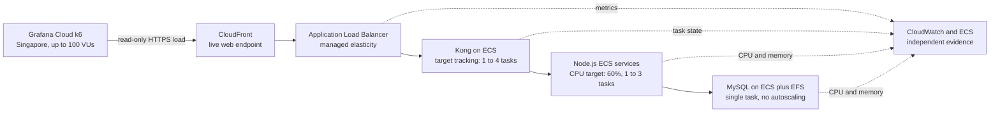

# OneStage live ECS autoscaling evidence

- **Course:** SWE5001 — Architecting Scalable Systems
- **Date:** 18 October 2026
- **Grafana test:** [OneStage read-only stress 2026-10-17](https://onestage.grafana.net/a/k6-app/tests/1393994)
- **Detailed run:** [Grafana Cloud run 8834114](https://onestage.grafana.net/a/k6-app/runs/8834114)
- **Target:** `https://d3vlw6jnm44c4l.cloudfront.net`
- **AWS account:** `195663985359` (`SWE5001`)
- **Region:** `ap-southeast-1`
- **ECS cluster:** `onestage-cluster`

## Objective and safety boundary

This exercise adds deployed scalability evidence to the existing k6 load, isolated buyer-workflow, end-to-end and browser evidence. It verifies whether live request traffic causes the configured ECS target-tracking policy to add capacity, whether the new targets become healthy, and whether the request path remains available during scale-out.

The workload was intentionally read-only. It did not join queues, create inventory holds or orders, initiate payments, issue or check in tickets, create events, send notifications, change subscriptions, or add, edit or delete users. Setup authenticated 22 retained synthetic users through AWS Cognito. No AWS service configuration, desired count, scaling limit, database, volume, subscription or payment plan was changed manually.

## Tested request and scaling path

## Load result

| Metric | Result |
|---|---:|
| Status | Finished; all thresholds passed |
| Duration | 9 min 30 sec |
| Maximum virtual users | 100 VUs |
| Grafana consumption | 15.84 VUh |
| Grafana request count | 94,439 |
| Average request rate | 154 requests/sec |
| Peak request rate | 328.92 requests/sec |
| Overall p95 response time | 78 ms |
| HTTP failures | 0 |
| Checks | 188.9K / 188.9K passed |
| Thresholds | 11 / 11 passed |

The AWS ALB independently recorded 94,442 requests over the corresponding observation interval. The three-request difference is immaterial and can include unrelated live or monitoring traffic; the two counters are correlated evidence, not expected to be transactionally identical.

## Autoscaling result

The baseline at 20:43:46 SGT was one desired and one running task for Kong, every Node.js service and MySQL.

| Time (SGT) | Kong desired | Kong running | Kong pending | Observation |
|---|---:|---:|---:|---|
| 20:43:46 | 1 | 1 | 0 | Pre-load baseline |
| 20:50:33 | 4 | 1 | 3 | Scale-out requested; new tasks starting |
| 20:51:34 | 4 | 4 | 0 | Scale-out converged |
| 21:01:52 | 4 | 4 | 0 | Stable after load; scale-in evaluation still in progress |

AWS Application Auto Scaling recorded one successful activity:

- Start: 20:49:49 SGT.
- End: 20:51:24 SGT.
- Policy: `onestage-kong-alb-req`.
- Cause: the high target-tracking alarm entered `ALARM`.
- Action: set desired count to four.

The ALB healthy-host metric increased from one to four, and target 5xx count remained zero. The activity completed in approximately 95 seconds; the periodic ECS observation saw all four tasks running within approximately one minute of the first observed desired-count change.

## AWS metrics during the run

### Request path

| Metric | Result |
|---|---:|
| ALB requests | 94,442 |
| Peak ALB requests per minute | 18,311 |
| ALB target 5xx responses | 0 |
| Healthy Kong targets | 1 to 4 |
| Mean ALB target response time | 11.66 ms |
| Maximum ALB target response time | 544.59 ms |

### ECS resource utilization

| Service | Peak CPU | Peak memory | Scaling result |
|---|---:|---:|---|
| Kong | 119.99% | 44.53% | Scaled from 1 to 4 |
| Event | 37.12% | 27.15% | Remained at 1 |
| Inventory | 56.56% | 22.07% | Remained at 1 |
| Queue | 15.75% | 21.88% | Remained at 1 |
| Order | 18.16% | 26.56% | Remained at 1 |
| Ticket | 34.53% | 27.15% | Remained at 1 |
| Auth | 14.17% | 20.90% | Remained at 1 |
| MySQL | 61.82% | 51.46% | Remained at 1; no autoscaling policy |

The Node.js services use a 60% CPU target and did not cross it during the one-minute CloudWatch periods. Inventory was closest at 56.56%. Their lack of scale-out is therefore an expected policy outcome, not evidence that scaling is broken. MySQL is outside Application Auto Scaling and remains a single compute and data-service failure domain.

## Recovery behavior

Kong's high alarm uses three one-minute evaluation periods and its low alarm uses 15 one-minute evaluation periods. The high alarm returned to `OK` at 20:58:49 SGT. At the final 21:01:52 SGT observation, Kong remained at four healthy tasks because the low alarm had not yet accumulated 15 consecutive low-load periods. This run validates fast scale-out and post-load stability; it does not claim that scale-in completed inside the observation window.

## Conclusion

This run demonstrates deployed horizontal elasticity at the ALB-to-Kong tier. Under a ramp to 100 VUs and 328.92 requests/sec, Kong automatically increased from one to four healthy tasks while the system completed 94,439 k6 requests with zero HTTP failures and a 78 ms p95 response time.

It is **not** evidence of full end-to-end horizontal scaling. The Node.js services had sufficient single-task CPU headroom and therefore did not scale. MySQL has no horizontal failover or replica in the current architecture. A future end-to-end scaling demonstration would need a workload that safely and deliberately crosses selected Node.js CPU targets plus a separate database HA design; it must not manufacture scaling by changing production desired counts during a test.

## Evidence limitations

- Metrics are one-minute CloudWatch aggregates and can hide short spikes.
- The workload covers read paths and does not represent write-heavy queue, booking or payment traffic.
- This was a short academic demonstration, not a soak, breaking-point or production-capacity certification.
- CloudFront and ALB are managed services; this evidence observes their request handling but does not expose their internal capacity changes.
- The live environment can receive unrelated requests, explaining small counter differences between Grafana and AWS.
- No failure injection, task termination, database failover or data-corruption recovery was performed.
